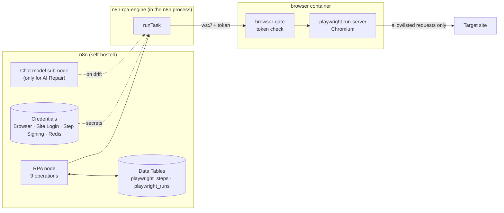

# n8n-nodes-rpa: RPA for n8n

Robotic process automation (RPA) for n8n. Take a screenshot of a page, read its text, save it as a PDF, extract a table or a list, fill in and submit a form, or download a file: fill in a URL and one or two fields, no code. For sites behind a login there is **Run Steps**, a signed list of browser steps that repairs itself with an AI chat model when the site changes, with a person approving every fix.

> **Status:** early release (0.1). Self-hosted n8n only. A personal open-source project (MIT), not an official n8n product. See [Project status](#project-status).

**Install** in a self-hosted n8n: **Settings → Community nodes → Install**, package `n8n-nodes-rpa`. The same tarball is attached to each [GitHub Release](https://github.com/jb-n8n/n8n-nodes-rpa/releases) for a manual install ([Operator guidance](#operator-guidance)). The node drives a browser it does not run itself, so you also need a browser server: the compose stack in this repository has one, the `rpa-browser` image is published as `ghcr.io/jb-n8n/rpa-browser`, and [Where the browser runs](#where-the-browser-runs) lists the alternatives. To try everything on your machine first, follow [Hello world in 10 minutes](#hello-world-in-10-minutes).

The repository is a pnpm monorepo:

| Path | What it is |
|---|---|
| `packages/engine` | The engine: step runner, policy, AI repair, proof, signing. Its only runtime dependencies are `playwright-core` and `fflate`, and it ships inside the node package (not published on its own). |
| `packages/n8n-nodes-rpa` | The community node **RPA**, published to npm as `n8n-nodes-rpa` and attached to each GitHub Release: the node, its four credentials, its workflow templates and the bundled engine. Its runtime dependencies are the engine's plus `redis` (the login breaker and lock shared across queue-mode workers). |
| `packages/eval` | The seeded heal-rate eval and the acceptance tests. |
| `sandbox/portal` | A mock site: public fixture pages (`/public/...`), a site behind a login with TOTP that changes on every "release", and attack pages. The Hello world template and the tests use it. |
| `images/browser` | The `rpa-browser` image: the browser server, the token gate in front of it (`images/browser/gate`) and the supervisor that runs both. The compose stack runs it. |
| `deploy/` | The browser service at scale: a Helm chart, Terraform modules and examples, and a script that configures n8n. |
| `desktop/` | Work in progress: the Windows desktop runner (C#, UI Automation) and ERP Demo, a sample WinForms app to drive. See [desktop/README.md](desktop/README.md). |
| `docs/` | Runbooks for the browser service at scale, the SAP look-alike onboarding runbook and the security review. See [Documentation](#documentation). |

**Contents**

- [What it is](#what-it-is)
  - [How it works](#how-it-works)
- [Hello world in 10 minutes](#hello-world-in-10-minutes)
- [Operations](#operations)
- [Where the browser runs](#where-the-browser-runs)
- [Safety model](#safety-model)
- [Locators](#locators)
- [ID Pattern in 60 seconds](#id-pattern-in-60-seconds)
- [Run Steps reference](#run-steps-reference)
- [The self-healing data feed](#the-self-healing-data-feed)
- [Error codes](#error-codes)
- [Migrating from toema/n8n-playwright](#migrating-from-toeman8n-playwright)
- [Operator guidance](#operator-guidance)
- [Development](#development)
  - [Repository layout](#repository-layout)
  - [Documentation](#documentation)
  - [Project status](#project-status)

## What it is

**RPA** is an n8n community node for self-hosted n8n. It drives a real Chromium browser that runs in its own container, so it can read pages that need JavaScript, fill in forms and save pages as PDF.

It is an **unverified community package for self-hosted n8n**. It cannot run on n8n Cloud, because it brings its own browser-automation library and needs a browser server it can connect to. The package does not ship a browser (see [Where the browser runs](#where-the-browser-runs)).

Nine operations, in this order:

| Operation | What it does |
|---|---|
| **Screenshot** | Take a screenshot of a page |
| **Get Page** | Get the text, HTML or title of a page |
| **Save as PDF** | Save a page as PDF |
| **Extract Data** | Extract a table or list from a page |
| **Fill and Submit Form** | Fill in and submit a form |
| **Download File** | Download a file from a page |
| **Run Steps** | Advanced: Run a list of browser steps |
| **Sign Steps** | Advanced: Sign a repaired step list |
| **Import Steps** | Advanced: Import steps from a recording, code or a UiPath bot |

What is different from other browser-automation nodes for n8n:

- **The browser goes only where you allow.** A run visits the site of the URL you typed, plus the sites you list under **Options → Also Allow These Sites**. Addresses on your own network (loopback, private, link-local) are blocked unless you turn on **Allow Private Network**. Every other request is blocked.
- **Passwords stay in n8n credentials.** They never appear in a step list, a log or a message to an AI model, and every text output is masked.
- **Step lists are signed.** Run Steps runs lists that a person approved and that carry an HMAC signature. When a site changes, an AI model can repair a list, a fresh browser proves the repair, and nothing is used until a person approves it with Sign Steps.

### How it works



The engine is built on Playwright (`playwright-core`), and the node is a thin n8n layer over it. The node reads parameters and credentials, enforces the literal-only switches, the login breaker and the per-Site-Login lock, and shapes outputs and error items. Every browser action goes through one engine entry point, `runTask` (`packages/engine/src/lane/task.ts`). The quick operations compile their fields into a step list and run it the same way Run Steps does, which is why each of them returns its `steps`.

**One run, step by step.**

1. **Parse and trust.** The step document is parsed and validated (`steps/parse.ts`, `policy/validate.ts`). Signed steps are checked against an HMAC over the canonical JSON, name, version, start site, Site Login id and approver, in the `pw-steps/2` domain (`sign.ts`, `lane/trust.ts`). A bad signature fails `script_untrusted` before a browser opens.
2. **Policy.** The allowed sites, the forms the run may submit and the write mode come from the URL, **Also Allow These Sites** or the Site Login credential (`policy/derive.ts`). Every request the page makes is checked in n8n's process against that policy, including the DNS result for private-network blocking and every redirect hop, before the browser sends it (`browser/session.ts`, `browser/redirects.ts`, `browser/address.ts`).
3. **Script lane.** The steps run in a fresh browser context on the remote Chromium (`lane/script-lane.ts`, `steps/run.ts`, `steps/handlers/*`). Secrets reach the page only through a `signIn` step on a listed login page, as placeholders the engine fills (`secrets/render.ts`, `secrets/totp.ts`). Every text output passes through a masker that knows every secret of the run in its raw, URL, JSON, HTML-entity, full-width and base64 forms, in any mix (`secrets/mask.ts`). Rows are checked against the total the page states (`verify/verify.ts`), and failures are classified into the [error codes](#error-codes) (`classify/classify.ts`).
4. **Agent lane (AI Repair only).** When a step no longer matches (`drift_detected`) and AI Repair is on, the connected chat model takes over **the same browser session**. It works from a masked accessibility snapshot of the page (`agent/snapshot.ts`) with a small tool set (`look`, `click`, `fill`, `select`, `sign_in`, `enter_code`, `dismiss`, `expand_all`, `next_page`, `extract`, `back`, `done`; `agent/tools.ts`, `agent/loop.ts`), within a budget of actions and tokens. The model never sees a password: `sign_in` and `enter_code` name fields by reference and the engine types the secrets. The snapshot includes what text fields, text areas and drop-downs currently hold (never password or credential-looking fields, or anything on a login page), so data on the page goes to the chat model's provider. Destructive-sounding controls are refused, by their names and by the full address a link or form goes to, query included (`cancel`, `delete`, `pay`, `send`, `purge` and similar words). Agent and proof sessions run under a no-write policy, and in them opening a page whose address names such an action ends the run (`policy_violation`), and so does a redirect to one, which is refused before the browser sends it. The start URL and the paths of the login pages are exempt.
5. **Compile.** The agent's successful actions are compiled back into ordinary steps (`compile/compile.ts`): login blocks are reused, exploration loops are pruned, a TOTP step added to a login is folded into it, and pagination gets headroom.
6. **Prove.** The compiled steps run again in a **fresh browser with no model and no writes** (`prove/prove.ts`, `lane/prove-run.ts`). Rows from the repair reach the Data output only if this proof passes, or if **Deliver Unconfirmed Rows** is on.
7. **Review, approve, sign.** A proven repair becomes a **Repaired Steps** item: version, hash, a review digest, the change list (every step whose action, locator, target or value changed, and every pop-up handler added or removed), safety flags (every host, form, download and pop-up handler the steps touch), and before and after screenshots. Template 3 emails it, waits for a person, and **Sign Steps** signs it with the Step Signing key. Until then it never runs. The next scheduled run uses the signed steps on the script lane, with zero model calls.

Debug traces have cookies, auth headers, storage, login bodies and binaries removed and known secrets masked (`trace/trace.ts`).

## Hello world in 10 minutes

You need Docker with Compose, `openssl`, and this repository.

1. Write the token the browser server will require and the key n8n encrypts credentials with, then start the stack (the first build takes a few minutes):
   ```bash
   printf 'BROWSER_TOKEN=%s\nN8N_ENCRYPTION_KEY=%s\n' "$(openssl rand -hex 32)" "$(openssl rand -hex 32)" > .env
   docker compose up --build -d
   ```
   Keep `.env`: without the same `N8N_ENCRYPTION_KEY`, n8n cannot read the credentials it saved. A stack started before `N8N_ENCRYPTION_KEY` existed already has a key in its `n8n_data` volume, and n8n refuses to start with a different one (`Mismatching encryption keys`). Print the old key with `docker run --rm -v n8n-rpa_n8n_data:/data:ro --entrypoint cat n8n-rpa/n8n:local /data/config` and add its `encryptionKey` value to `.env` as `N8N_ENCRYPTION_KEY` instead of a new key (do not overwrite `.env` with the command above), or start fresh with `docker compose down -v`, which deletes the stack's workflows and credentials.
   It runs n8n with the node already installed at http://localhost:5678, a pinned browser server behind a token check ([Where the browser runs](#where-the-browser-runs)), the sandbox site at http://localhost:8080, and Mailpit, an inbox for approval emails, at http://localhost:8025. To start or restart only the browser later: `docker compose up -d browser`.
2. Open http://localhost:5678 and create the owner account.
3. Create the credential: in the left sidebar, **+ → New credential → RPA Browser** (a new n8n has no Create button on an empty Overview).
   - **Mode**: Browser Server
   - **Endpoint URL**: `ws://browser:3000/`
   - **Token**: the value after `BROWSER_TOKEN=` in `.env` (print it with `grep BROWSER_TOKEN .env`)
   - **Private Network Endpoint**: on. The server sits on the Docker network, which is a private address, and the node refuses a plain `ws://` address on a private network unless this is on and a token is set.

   Click **Save**. n8n tests the credential and the modal says `Connection tested successfully` (n8n's own text). The node's own result, `Connected to the browser server (1.63)`, shows when the credential is tested through n8n's API.
4. Create a workflow, then **... → Import → From file** and pick `packages/n8n-nodes-rpa/templates/hello-world.json`. Pick the credential on both RPA nodes. Click **Execute workflow**.
5. What you get:
   - **Screenshot example.com** returns `url`, `title`, `status: 200`, `steps` and a PNG in the binary field `screenshot` (open the **Binary** tab).
   - **Extract the sandbox table** (Extract Data) returns three items: `{ Code: "SKU-1001", Product: "Widget", Price: "$10.00", Stock: "12", _meta: { ... } }` and the same for `SKU-1002` and `SKU-1003`. The sandbox site is on your own network, so that node has **Options → Allow Private Network** on. Leave the option off for public sites.

If the first run fails, read the message:

| You see | What to do |
|---|---|
| `browser_unavailable: Could not connect to the browser server at ws://browser:3000/. Is it running? ...` | Start the browser: `docker compose up -d browser`. |
| `browser_unavailable: The browser server at ws://browser:3000/ refused the token. Check the Token in the RPA Browser credential.` | Copy the token from `.env` into the credential again. After changing `.env`, run `docker compose up -d browser` so the server picks it up. |
| `browser_unavailable: The browser server is version X but this node needs Y. ...` | Use the image the message names. See [Where the browser runs](#where-the-browser-runs). |
| `policy_violation: Blocked: sandbox:8080 resolves to a private network address. ...` | You changed the Extract node. Turn **Options → Allow Private Network** back on for sites on your own network. |

**n8n outside the compose stack** (n8n running on your machine, or your own n8n): start the browser and the sandbox with the development override, which publishes the browser on `127.0.0.1:3000` (`docker-compose.dev.yml`):

```bash
docker compose -f docker-compose.yml -f docker-compose.dev.yml up -d browser sandbox
```

Use `ws://127.0.0.1:3000/` as the Endpoint URL and keep the token. The node checks every address the browser opens from n8n's own process, so a page name must resolve there too, and on your machine `sandbox` does not. Point the Extract node at the sandbox container's address on the compose network instead: `http://<ip>:8080/public/table`, where `<ip>` is printed by `docker inspect -f '{{range .NetworkSettings.Networks}}{{.IPAddress}}{{end}}' $(docker compose ps -q sandbox)`. Public pages such as `https://example.com` work unchanged. To install the node into your own n8n, see [Operator guidance](#operator-guidance).

Next, change **Operation** on the first RPA node to try the others. The quick operations take a URL and one or two fields; each shows the step list it ran in its output (`steps`), ready to paste into Run Steps.

## Operations

Every operation except Sign Steps uses the **RPA Browser** credential. The six quick operations take no login: they are for public pages. For anything behind a login use [Run Steps](#run-steps-reference) with an **RPA Site Login** credential.

**What every quick operation has**
- **URL** (required): only `http` and `https`. Only this site is visited. Other sites are blocked. Add more under **Options → Also Allow These Sites**. A URL that still contains `{{` after n8n resolved its expressions is a configuration error: `URL must not contain {{ }} templates`.
- **Options** (closed by default):

| Option | Default | What it does |
|---|---|---|
| **Wait Until** | Load | Load, DOM Content Loaded or Network Idle. Network Idle can hang on pages that keep polling. |
| **Wait for Element** | none | An element waited for (visible) before acting. |
| **Timeout (Seconds)** | 30 | Per step. |
| **Max Seconds** | 180 | The whole run; at most 300. |
| **Viewport** | 1280 x 800 | Width (320 to 3840) and height (240 to 2160); values outside are clamped. |
| **Also Allow These Sites** | empty | Other hosts the page may open or load files from, separated by commas. No wildcards. |
| **Allow Private Network** | off | Admit addresses on your own network for the allowed sites. Set it directly; an expression is a configuration error. |
| **Debug Trace** | On Failure | Attach a scrubbed browser trace as binary `trace`: On Failure, Always or Never. |
| **Max Items** | 100 | More input items than this fail before any run starts. |

- **Output envelope**: `{ url, title, status, ...operation fields, steps, blockedRequests }`. `url` is the final address after redirects, `status` is the HTTP status of the page (a 401, 403 or 429 succeeds and reports its `status`, so the workflow can branch; a 404 or 410 fails `not_found`; a server error fails `site_down`), `steps` is the step list the operation compiled to, and `blockedRequests` lists writes that were blocked (method, host, path) when there were any.
- **Binary files**: Screenshot and Save as PDF put their file in the field named by **Options → Put Output in Field**, and the file is named after that field: `screenshot.png`, `pdf.pdf`, or `pageShot.png` for a field called `pageShot`. Put Output in Field cannot be `trace`, because the debug trace uses that field: `Put Output in Field must not be "trace": the debug trace uses that field.`
- Each input item is one run in a fresh browser context, one after another. Nothing (cookies, storage) carries over between items, nodes or executions.

### Screenshot

Fields: **URL**; **Capture**: Full Page (default), Viewport or One Element (then an **Element** locator, see [Locators](#locators)). Options: **Put Output in Field** (default `screenshot`).
Output: the envelope and a PNG in binary `screenshot` (`screenshot.png`). In `steps`, Full Page is written as the Run Steps value `capture: "full"`.
Example: URL `https://example.com`, then an email node with **Attachments** set to `screenshot`.

### Get Page

Fields: **URL**; **Return**: Text (default), HTML or Title and URL Only.
Output: the envelope plus `text` or `html`, and `truncated: true` when the page was larger than 5 MB.
Example: **Return** Text, then an AI node with `{{ $json.text }}` as its prompt.

### Save as PDF

Fields: **URL**; **Paper**: A4 (default) or Letter. Options: **Print Background** (off), **Put Output in Field** (default `pdf`).
Output: the envelope and a PDF in binary `pdf` (`pdf.pdf`). It needs headless Chromium; with a headed browser it fails `incomplete` with `Save as PDF needs headless Chromium`.

### Extract Data

Fields: **URL**; **Shape**: Table or List of Items.
- **Table**: a **Table** locator that matches exactly one `table`. Headers come from `thead th`, else the first row. An empty header becomes `column_N`, a duplicate becomes `name_2`. A cell that spans columns is not expanded.
- **List of Items**: an **Item** locator that matches every item, and **Fields** (name, locator, **Attribute**). Field locators are resolved inside each item and must match at most one element there; none gives an empty value, more than one fails `drift_detected`. **Attribute** is Text (default), `href`, `src`, `title`, `alt` or `aria-label`; `href` and `src` come back as absolute URLs. Without Fields, each row is the item's text in a field named `text`. `_meta` and `id` cannot be field names.

Options: **Output** (One Item per Row, default, or All Rows in One Item), **Next Page** and **Max Pages** (default 10) to read every page, **ID Pattern (Regex)**, **Stated Total Pattern (Regex)**, **Required Fields** (List of Items), **Text That Means No Results (Regex)**.

Output: One Item per Row gives each row's fields plus `_meta: { url, title, status, rowCount, confirmed, row }` (the first row's `_meta` also carries `steps` and `blockedRequests`). All Rows in One Item gives the envelope plus `rows`, `rowCount` and `confirmed`. Without an ID Pattern rows have no `id` key and are not de-duplicated. Zero rows is `incomplete`, unless **Text That Means No Results** matches the page, which gives one item with `rowCount: 0`.

**Stated Total Pattern** is the only count check, and it runs only when you set it: a regular expression whose first group is the total the page states. When it matches and the row count differs, the run fails `incomplete`. `confirmed` is `true` only when a Stated Total Pattern is set and the page's total matched the row count; without the option, or when the page shows no matching text, `confirmed` is `false` and the rows still come through.

Example: Shape Table, **Table** = CSS Selector `table.results`, **Stated Total Pattern** `Showing (\d+) results`, on the sandbox's `/public/table`, gives three rows with `confirmed: true`.

### Fill and Submit Form

Fields: **URL**; **Fields** (a locator and a value each); **Submit Button** (a locator).
Output: the envelope plus `text` (the page after the submit), `submitted` and `writes` (method, host, path of every request sent).
- The panel says: "Submits a form on the URL's site. Posts to other sites are blocked." and "Do not type passwords here."
- **Text fields only.** It fills text fields; use Run Steps (`select`, `check`) for selects and checkboxes.
- Values are never written into the step list: they travel as variables (`{{var.f0}}`, `{{var.f1}}`, ...), at most 10,000 characters each.
- Writes are allowed only while the submit button is clicked: at most 3 POST requests, each to the URL's site or an allowed site. A form whose `action` or button `formaction` points at another site fails before the click.
- **Check `submitted`.** A click that sent no POST (the page handled it in script, or nothing happened) is still a success, with `submitted: false` and `writes: []`. Branch on `{{ $json.submitted }}` when the post matters.
- A password field is refused: `Fill and Submit Form cannot fill password fields. For sites behind a login, use Run Steps with a Site Login.`
- **Typed values can show up in outputs.** The saved trace removes the bodies of the posts, but it still holds the values typed into the fields, and the page text after the submit (`text`) can echo what you sent. Set **Options → Debug Trace** (`saveTrace`) to Never for sensitive form data.
- **Its `steps` output does not run unchanged in Run Steps.** The values are `{{var.f0}}`, `{{var.f1}}`, ... placeholders, so Run Steps needs them under **Options → Variables**. Run Steps also has no write window: the submit click's POST navigates the page, and a blocked navigation always ends the run, so the step fails `policy_violation` (signed or unsigned) and nothing is sent. To send the form from Run Steps, replace the click with a `submit` step that declares the form's host, path and method (unsigned steps also need **Allow Unsigned Writes**).
- A submit is not idempotent. n8n's **Retry On Fail** or a re-run repeats it. When a run fails after the form was sent, the error item says `details.submitted: true`.

### Download File

Fields: **URL**; **Download Link or Button** (a locator). Clicking it must start a GET download.
Options: **Allowed File Types** (default CSV, Plain Text, PDF, XLSX; also JSON, ZIP, PNG, JPEG, DOCX; checked by the file contents), **Max File Size** (MB, default 50, at most 200), **Put Output in Field** (default `file`).
Output: the envelope plus `fileName`, `mimeType`, `bytes` and the file in binary `file`, under the file name the site gave it (for example `report.csv`). The envelope's `status` is `null`: the last navigation of the page is the file itself, which has no page status. Files are never extracted (a ZIP stays one file). A download that needs a POST is a Run Steps job with a declared `submit` target.

### Run Steps

Runs a list of browser steps you wrote or that Sign Steps signed. See [Run Steps reference](#run-steps-reference).

### Sign Steps

Signs a **Repaired steps** item from Run Steps or Import Steps after a person approved it (**Approved** on), or records a rejection (**Approved** off). No browser is opened. **Approved By** must be on the **Approver Allowlist**. See [The self-healing data feed](#the-self-healing-data-feed).

**Write Steps** (desktop steps only): the numbers of the steps that save, post or submit, as the approver declared them (`16`, or `7, 9`). Sign Steps adds `"write": true` to exactly those steps and signs the result; nothing else changes. Its output names them, `writeSteps` (`[{ "step": 16, "intent": "Click Save" }]`) and `writeLine` (`Signed as writes: step 16 (Click Save)`, or `Signed as writes: none (no step was listed in Write Steps)`), which template 3's **Email signed steps** sends the approver. A listed step may act on the write controls and gated keys of the desktop runner's policy; the runner refuses a write only on those, so leaving a step unlisted does not stop it from saving unless its control is in the runner policy. A step that cannot be a write (a wait, a read, an expected file) or a number outside the steps is refused, and browser steps refuse any value here. For desktop steps the change list must show every step, in order (the approval email numbers it, `Step 16: Click Save (…)`, the numbers Write Steps takes), and the safety flags must be the full list (the app, each returned file, each declared write and each candidate write); the signature binds the app, never a Site Login.

### Import Steps

Turns a recording or a bot you already have into steps for approval. It reads one file per input item, builds a draft step list, runs it once and replays it in a fresh browser, and puts what passed on the **Repaired Steps** output: the same item Run Steps puts there after a repair, so the approval workflow and **Sign Steps** take it unchanged. Nothing it imports runs on a schedule until a person approves it and Sign Steps signs it.

Fields:
- **Source**: **Chrome Recorder (JSON)** (a recording exported from the Recorder panel of Chrome DevTools), **Playwright Code (JavaScript or TypeScript)** (code from the Playwright recorder, `npx playwright codegen`; Python, Java and C# are refused), or **UiPath Project (ZIP or XAML)** (the project folder as a .zip, or one .xaml workflow).
- **Input From**: **Binary File** (default; **Input Binary Field**, default `data`, for example a Form Trigger upload) or **Text** (**Recording or Code**, pasted). A UiPath project is always a file. A file or text over 20 MiB is a configuration error and is not read: `The file is larger than 20 MiB, so it was not read.`
- **Name** (required): the steps' name. A UiPath project gives one step list per browser sequence, named `<name>-1`, `<name>-2` and so on. A Name starting with `=` is refused.
- **Start URL**: the site the steps may visit. Empty means the first page the recording opens; with an **RPA Site Login** the credential sets the sites, as in Run Steps.
- **AI Repair** (on by default) and **Goal**: with a chat model on the **Model** input, a draft that no longer matches the page is repaired, once per execution as in Run Steps. An empty Goal means "do what the imported steps do".
- **ID Pattern (Regex)** for steps that read rows, or **Expected File (First Version)** for steps that download a file. With an Expected File the click that exports becomes a checked `download` step: a click the source marked as a download, else the last click named like export, download, csv, xlsx or spreadsheet, else the last click. When that export click opens a dialog (SAP's Spreadsheet... opens "Select Spreadsheet"), a confirming click after it, such as Continue, OK or Save, downloads instead, but only when it is the recording's last click and no address change or URL check lies between the two. A Chrome DevTools Protocol (CDP) browser cannot read downloads, so an Expected File there is refused before anything is read.
- **Options**: **Variables** (a typed value equal to a variable becomes `{{var.name}}`), **Timeout**, **Max Seconds**, **Viewport**, **Also Allow These Sites**, **Allow Private Network**, **Login Breaker Reset Key**, **Debug Trace**, **Max Items**.
- Credentials: **RPA Browser**, **RPA Site Login** when the recording signs in, and **RPA Redis** (optional; needed in queue mode with a Site Login, as in Run Steps). No Step Signing key: Sign Steps signs.

What is never imported: a value typed into a password, PIN or code field, or equal to the Site Login's username or password. The sign-in becomes one `signIn` step that types the credential's values; without a Site Login it is removed and the report says so. An identity-first sign-in (the email on one page, **Next**, the password on the next page) becomes a `signIn` with `next` when exactly one click or Enter separates the two pages; Enter becomes a click on the form's submit button, and the report says so. A sign-in over three or more pages, with a detour or a field between the pages, or whose Next opens a new tab is reported for you to add by hand, and its values are stripped all the same. A code typed from an expression or a variable, such as a UiPath TOTP activity's output, into the code field right after the sign-in's submit becomes the sign-in's code and is reported as a secret; it counts as the code field when the value is a TOTP activity's output or the field's own label or locator names a code (one-time, verification, authentication, OTP, 2FA, MFA, security code, or exactly Code), so SAP's command field or a Company Code typed from a variable stays a step. TOTP activities (GenerateTOTP, GetTotpCode, GenerateOneTimePassword, GetOtp) are converted with no step: the Site Login's authenticator secret types a fresh code. The gated "Stay signed in?" answer: a button named No, Yes or "Don't show this again" (any case) clicked right after the built sign-in becomes a `when` step in the sign-in block (so does a "Don't show this again" checkbox ticked before it), reported converted; URL checks and waits before it are dropped.

Adoption never writes. Imported steps that `submit` a form or `download` through a form post are refused before the browser opens, every session makes no form submissions or writes (**Requests That Only Read** still pass), and no rows or files from these runs are delivered. Each step list runs once and is then replayed in a fresh browser with its own budget, so allow about twice **Max Seconds** per step list. On sites with an authenticator code, **Max Seconds** must leave room for up to a 30 s wait: the replay waits for a fresh code inside its budget. The Site Login's login breaker and run lock apply as in Run Steps. One input item adopts at most 10 step lists, one after another.

Outputs:
- **Repaired Steps**: one item per adopted step list, version 1 with no base version, every step listed as new.
- **Data**: one item `{ report, drafts: [{ name, steps, adopted, code?, reason?, traceRef? }], workflowName? }`. A UiPath desktop list is a draft with `surface: "desktop"`, `adopted: false`, `forApproval: true`, `writeCandidates` (step numbers), `variables` and `secretVariables`; its Repaired steps item goes to Repaired Steps without a replay (see [Desktop runs](#desktop-runs)), and report items of kind `candidateWrite` name the steps that may write. A draft whose steps contain a value of the RPA Site Login shows `steps: null` and says so in `reason`. The report lists every step that was not translated, dropped, converted or removed as a secret. Steps that cannot be proved (screenshot, PDF or read steps, rows without an ID Pattern, a download without a check that names the file) come out here with `adopted: false` and the reason, never on Repaired Steps. For UiPath, binary `workflow` (`<name>.workflow.json`, `application/json`) is an n8n workflow around the browser steps: open it with **Import from file**. Each browser sequence becomes **Get active steps** and **Run steps** with signed steps required and AI Repair on, with its own **Chat model** (pick its credential) and its Repaired Steps output going to an **Approve steps** node (pick **RPA: 3 Approve steps** there); stickies mark what was not translated.
- Error output: a configuration problem, nothing imported, or every step list failed (for example `drift_detected` without a model, or `login_failed`). The item carries the report and the reasons under `details`.
- **Debug Trace** (On Failure by default): a step list that failed in the browser brings its trace, scrubbed as in Run Steps and scrubbed again by the node, and its failure screenshot, whose credential fields the engine masks as in Run Steps (the node does not check the image again). On the error item the first failure's screenshot and trace are binary `screenshot` and `trace` (`details.traceRef`); every other failed step list's trace is `trace-<n>`, `n` its index in `drafts`, on the error item or on Data, named by that draft's `traceRef`. **Never** attaches none. Agent transcripts are never attached.

Import messages, in the report, on Data (`reason`) or on the error output:
- `The recording signs in: attach an RPA Site Login so the import can sign in without the typed password.`
- `Imported steps that submit a form or post to download cannot be adopted: repair and import never write.`
- `These steps read no rows and download no file, so there is nothing to prove: the draft is returned for review but cannot be signed.`
- `Only JavaScript or TypeScript Playwright code can be imported; record with --target javascript.`
- `Nothing in this file could be turned into steps.`
- `The imported steps ran, but replaying them in a fresh browser did not pass the proof, so there is nothing to sign`, followed by the reason.

**First day: import a bot.** Import `packages/n8n-nodes-rpa/templates/5-import-a-bot.json` (**RPA: 5 Import a bot**) after workflows 1 and 3. Its form asks for the bot file, the source and a name, and optionally the file name pattern and required columns of the file the bot downloads (they become **Expected File**). Where each source comes from:
- **Chrome Recorder**: in Chrome DevTools open the **Recorder** panel, record the task once, then **Export → JSON**.
- **Playwright code**: run the Playwright recorder, `npx playwright codegen` with your site's address, and save the JavaScript or TypeScript it writes.
- **UiPath**: zip the project folder (the one with `project.json`), or pick one .xaml workflow.

What gets stripped: every value typed into a password, PIN or code field, and every value equal to the Site Login's username or password. The sign-in becomes one `signIn` step (with `next` when the email and the password are on two pages one click or Enter apart); without a Site Login it is removed. A code typed from an expression or a variable (a UiPath TOTP activity's output) into the code field right after the submit becomes the sign-in's code, reported as a secret, and TOTP activities are converted with no step (the Site Login's authenticator secret types a fresh code). A No, Yes or "Don't show this again" answer to "Stay signed in?" right after the sign-in becomes a `when` step in the sign-in block, reported converted, and URL checks and waits before it are dropped. Hovers and scrolls are dropped, and steps the node has no verb for (page JavaScript, keys other than Enter, SAP GUI and other desktop activities UI Automation cannot drive) are not translated (desktop activities on UI Automation apps become desktop steps: see [Desktop runs](#desktop-runs)); the report lists each one with its reason. What happens next: **Import steps** runs the draft once and replays it in a fresh browser without writes, the steps that passed go to **RPA: 3 Approve steps**, where each step list gets its own approval (a UiPath project can give several: **Approve steps** runs once for each item), and the form's last page says `Imported: <n> steps; <m> not translated, <k> removed as secrets.` and how many step lists wait for approval. A UiPath import also downloads `<name>.workflow.json`, the rest of the bot as an n8n workflow (n8n's Form Ending page returns it as a file). Nothing runs on a schedule until a person approves the steps and **Sign Steps** signs them. The form asks for a user name and password (Basic Auth) by default, and its credential slot ships empty: before the first run, open **Import a bot** and pick or create a Basic Auth credential (**Credential → + Create new credential → Basic Auth**, a user name and password of your choice). Keep **Authentication** on: an anonymous form could start logins with the attached Site Login (login breaker trips) and spend on the chat model.

The form's page stays open until the import ends, which can take about twice **Max Seconds** per step list. Behind a reverse proxy, set its read timeout above that (for nginx, `proxy_read_timeout`), or the browser shows a timeout error while the import keeps running. Don't submit the form again after a timeout: the first import still finishes, its steps still go to approval, and its result is in **Executions**. A second submission imports the same bot again and signs in again.

## Where the browser runs

This is the section for whoever runs the browser. The node never ships a browser. The **RPA Browser** credential says where Chromium runs, and the node talks to it over the Playwright protocol, so the browser server is a Playwright server: the image, its version and any hosted endpoint must match it.

| Where | Use it for | Endpoint URL |
|---|---|---|
| Compose stack (`docker-compose.yml`) | The reference setup and this README | `ws://browser:3000/` (Private Network Endpoint on, token required) |
| `docker run` | A single machine without compose, development only | `ws://127.0.0.1:3000/` |
| A hosted Playwright endpoint such as Browserless | Production | `wss://...`, token in the Token field |
| Kubernetes or Amazon ECS (`deploy/`) | Production at scale, next to n8n in queue mode | `ws://rpa-browser.<namespace>.svc.cluster.local:3000/` or `ws://<internal load balancer>:3000/` (Private Network Endpoint on, token required) |
| Local Browser | Development only | none; run `npx playwright install chromium` |
| Chrome DevTools Protocol | Other browser vendors; lower fidelity. Downloads are refused: a CDP connection cannot read downloaded files, so Download File, steps with a download and a first run with an Expected File fail up front with a configuration error | `wss://...` or `https://...` for discovery |

**Compose.** The `browser` service runs `playwright run-server` on the container's loopback (port 3001), behind a small gate on port 3000 that checks the token (`images/browser/gate/gate.mjs`, no dependencies). The browser runs in its own network namespace, so it cannot reach n8n's loopback, and no port is published on your machine: n8n connects to `ws://browser:3000/` over the compose network. The gate accepts a connection only with `Authorization: Bearer <BROWSER_TOKEN>`, the value in `.env`, and refuses launch options other than `headless`, `timeout` and `slowMo`. Behind the gate, the run-server answers only on a random path generated at each container start; its output is discarded so that path never reaches `docker logs`, while the gate's own errors still do. If either process stops, the container exits and Docker restarts it; `docker stop` stops the gate first, then the run-server. The `rpa-browser` image is built from `images/browser/Dockerfile`: the pinned Playwright image plus `playwright` 1.63.0, installed at build time from `images/browser/server/package-lock.json` with its integrity hashes checked, so the container downloads nothing at start. The gate and the supervisor (`images/browser/entrypoint.sh`) are part of the image, and `tini` is its PID 1. The container runs with no Linux capabilities, `no-new-privileges`, 2 GB of memory and at most 1024 processes.

**Sessions, health, metrics and stop.** The gate takes at most `BROWSER_GATE_MAX_SESSIONS` sessions at a time (default 4, from 1 to 64) and answers more with `503`, `X-RPA-Browser: busy` and `Retry-After: 2`. `GET /healthz` (or `HEAD`, without a body) on port 3000 answers `200 ok`, or `503` while the gate is stopping or the browser server does not accept connections. Both ports listen on IPv4 and IPv6. A session whose connection to the browser server is not up within 10 s is dropped, and the gate turns on TCP keepalive (30 s) for session connections. Prometheus metrics are at `/metrics` on port 9464 (`BROWSER_GATE_METRICS_PORT`; `0` turns them off): `rpa_browser_sessions_active`, `rpa_browser_sessions_capacity`, `rpa_browser_draining`, `rpa_browser_sessions_total` and `rpa_browser_refused_total{reason}`. They hold counts only, never a header, path or token; keep the port off any load balancer. When the container is stopped the gate drains: it refuses new sessions with `503` and `X-RPA-Browser: draining`, waits up to `BROWSER_GATE_DRAIN_SECONDS` (default 600) for the open sessions to end, then exits, and only then does the browser server stop. A second stop signal (for example a second `docker kill -s TERM`) ends the drain at once. The browser server and its browsers run without the gate token in their environment. Docker kills a container 10 s after `docker stop` unless you pass `-t` or set `stop_grace_period`, so in Compose a session still running after that is cut. A bad value in any of these settings stops the gate at start with a message naming the setting.

**On Amazon ECS** (both settings off by default; nothing changes for Compose or Kubernetes). `BROWSER_GATE_ECS_PROTECTION=on` keeps the task out of scale-in and deployments while a session is open: the gate asks the ECS agent (at `ECS_AGENT_URI`, which ECS sets in every container) to protect the task for the drain time plus 5 minutes, renews that 5 minutes before it runs out, and clears it when the last session ends and again on exit. The task role needs `ecs:UpdateTaskProtection`. Without `ECS_AGENT_URI`, or with a value that is not an http URL, the gate logs once that task protection is off (never the value) and carries on. An agent error is logged with its HTTP status and AWS error code only and never affects a session. `BROWSER_GATE_EMF=on` prints one CloudWatch embedded metric format line on stdout every 60 s: `SessionsActive` and `SessionsCapacity` in the namespace `RPA/Browser`, with the dimension `ServiceName` set from `BROWSER_GATE_SERVICE_NAME` (required with EMF on; the gate stops at start without it). While the gate drains, both are reported as 0, so target tracking sizes the service on the tasks that stay; the Prometheus metrics keep the real counts and `rpa_browser_draining`. Both settings take `on` or `off`.

The stack has two networks. The `browser` network holds n8n, the `browser` service and `sandbox`; `mail` holds n8n and `mailpit`. The browser is not on `mail`, so a page that took over the browser cannot read approval links from Mailpit's inbox. It can still reach the sandbox, the internet, and n8n on port 5678: n8n is on `browser` because it connects to the browser, and Docker networks do not limit direction. For production, put an egress firewall in front of the browser (for example `DOCKER-USER` iptables rules on the Docker host, or a hosted browser with an egress allowlist) that lets it reach only the sites your runs visit and never n8n. The service, from `docker-compose.yml`:

```yaml
  browser:
    build:
      context: images/browser
    image: n8n-rpa/rpa-browser:local
    restart: unless-stopped
    user: pwuser
    working_dir: /home/pwuser
    security_opt: [no-new-privileges:true]
    cap_drop: [ALL]
    mem_limit: 2g
    pids_limit: 1024
    environment:
      BROWSER_GATE_TOKEN: ${BROWSER_TOKEN:?set BROWSER_TOKEN in .env}
      BROWSER_GATE_PORT: "3000"
      BROWSER_UPSTREAM_PORT: "3001"
    networks: [browser]
```

Credential: Mode **Browser Server**, Endpoint URL `ws://browser:3000/`, **Private Network Endpoint** on, Token = `BROWSER_TOKEN`. Start only the browser with `docker compose up -d browser`. `.env.example` shows the token line (`BROWSER_TOKEN=`, at least 32 characters; generate one with `openssl rand -hex 32`). A wrong token fails `browser_unavailable` with `The browser server at ws://browser:3000/ refused the token. Check the Token in the RPA Browser credential.` `docker-compose.dev.yml` publishes the gate on `127.0.0.1:3000` for tools on your machine and for `ACCEPTANCE_COMPOSE=1`; connect to `ws://127.0.0.1:3000/` with the same token.

**The published image.** Releases of the `rpa-browser` image are published from GitHub Actions as `ghcr.io/jb-n8n/rpa-browser:<version>` (linux/amd64 and linux/arm64, with a build attestation: `gh attestation verify oci://ghcr.io/jb-n8n/rpa-browser:<version> --owner jb-n8n`). The image has its own version (`browser-v<version>` tags); its Playwright version is in the image's run-server and must match the node's (see **Version matching** below). To run it without compose: `docker run -d --name rpa-browser -p 127.0.0.1:3000:3000 --cap-drop ALL --security-opt no-new-privileges:true -e BROWSER_GATE_TOKEN=<token> ghcr.io/jb-n8n/rpa-browser:<version>`, then Endpoint URL `ws://127.0.0.1:3000/` and the same token.

**Deploy at scale.** `deploy/` runs the same `rpa-browser` image as a scaled service next to an n8n in queue mode, so Chromium never runs in an n8n pod or task. Each replica serves a fixed number of sessions; the service scales on session use (ECS, or Kubernetes with KEDA and Prometheus) or on CPU, and drains open sessions on scale-in. The Helm chart is `deploy/helm/rpa-browser`; the Terraform modules are `deploy/terraform/modules/k8s-browser` (Kubernetes) and `deploy/terraform/modules/aws-ecs-browser` (an existing n8n on Amazon ECS); `deploy/terraform/examples/` has an attach example for each, and one that deploys n8n on EKS with n8n's own module plus a worker pool for RPA. After `terraform apply`, `terraform output -raw configure_command` prints the `deploy/scripts/configure-n8n.mjs` command: with `N8N_API_KEY` and `RPA_BROWSER_TOKEN` exported in the environment (never as flags or inline on the command line), it creates the RPA Browser credential through n8n's public API and imports the templates. Then run `0-connection-check.json` with your login page as the URL: the screenshot proves the network path, the egress rules and TLS before anyone writes steps. `make -C deploy check` validates all of it without a cloud account, and `deploy/test/kind-e2e.sh` runs the chart on a throwaway kind cluster to check the session limit and that a deleted pod waits for its open session. The runbooks take an owner through it step by step: [`docs/deploy/kubernetes.md`](docs/deploy/kubernetes.md) for Kubernetes and EKS, and [`docs/deploy/aws-ecs.md`](docs/deploy/aws-ecs.md) for Amazon ECS. They cover the prerequisites, the token, `terraform apply`, the first day, sizing, the security notes, checking that scaling works, and a first-apply checklist.

**`docker run`.** An ungated run-server on your machine's loopback; Endpoint URL `ws://127.0.0.1:3000/`, Token empty. `playwright run-server` has no token check of its own, so anyone who can reach that port can drive the browser. Bind it to loopback and never publish it further:

```bash
docker run -d --name browser --init -p 127.0.0.1:3000:3000 mcr.microsoft.com/playwright:v1.63.0 \
  /bin/sh -c "npx -y playwright@1.63.0 run-server --port 3000 --host 0.0.0.0"
```

**Version matching.** The Playwright version of the node and the server must match. This package uses `playwright-core` 1.63.0, so the image is `mcr.microsoft.com/playwright:v1.63.0` and the server is `playwright@1.63.0` (pinned in `images/browser/server/package-lock.json`). A mismatch is reported by the credential test and by the run (see [Error codes](#error-codes)); the credential test reports the version it needs (`Connected to the browser server (1.63)`).

**Hosted endpoints and other vendors.** Any hosted endpoint that runs a Playwright 1.63 server works in mode **Browser Server** (Browserless: its Playwright endpoint, `wss://...`, token in the credential). Vendors that only speak the Chrome DevTools Protocol connect in mode **Chrome DevTools Protocol (CDP)**, with lower fidelity. In both modes the engine checks redirect hops through a browser-level DevTools session, so the endpoint must allow one. If the endpoint shares one browser between clients, every request in that browser waits for that check while a run is open. Other clients' requests then pass unchanged, except redirect hops inside their same-process sub-frames, which the engine cannot tie to a client and checks against the run's policy. The `rpa-browser` image gives each connection its own browser.

**Traces.** The `trace` binary that **Debug Trace** attaches is a Playwright trace. Open it with `npx playwright@1.63.0 show-trace trace.zip`. Each step is a named group in it: `Step 4: Open Service`, `AI: Click ☰ Menu` for the repair agent's actions, `Proof: …` for the fresh-browser proof.

**Slow Motion.** The RPA Browser credential's **Slow Motion (ms)** makes the browser wait before each action, so a run can be followed in a live view or a demo (over CDP or a Browser Server, a live view attached to the page can also show the running step). Keep it at 0 in production: it slows every run.

**Which endpoint addresses are accepted.**
- `ws://` only for loopback (`127.0.0.1`, `localhost`, `[::1]`), or for a host on a private network when **Private Network Endpoint** is on and a token is set.
- Every other endpoint must be `wss://` with a token. Put the token in the Token field, never in the URL.
- **Local Browser** runs with n8n's network identity and filesystem and cannot apply the "any site may load files" rule. Use it for development.

**Address checks run in n8n, not in the browser.** The private-network block resolves host names with n8n's own resolver and checks the server address the browser reports for each response. A remote browser behind an explicit proxy, or with its own DNS view (split-horizon DNS, its own `/etc/hosts`), can reach a different address than the one n8n resolved, and the reported server address may be the proxy's rather than the site's. Give the browser the same DNS view as n8n and no forward proxy, or treat the browser's network as the boundary and let it reach only what runs may visit.

Two details of n8n's side:
- Hosts you listed (the URL's site, **Also Allow These Sites**, the Site Login's sites) are resolved like any other program on the n8n machine, `/etc/hosts` included.
- Hosts allowed only by the "any site may load files" wildcard are resolved with c-ares, n8n's DNS client, straight from the DNS servers: `/etc/hosts` is skipped. A VPN split-DNS name that only your system resolver knows does not resolve that way, so a file from such a host is blocked: wildcard-only names fail closed. List the host in Allowed Hosts (**Options → Also Allow These Sites**) to resolve it like a listed site.

## Safety model

On one page. A run can only do what the table says. A POST you list in **Requests That Only Read** on the RPA Site Login is taken on trust: it passes without any check of what it sends (see **Sites that post to read** below).

| Operation | Sites the browser may open | What it may send | Secrets |
|---|---|---|---|
| Screenshot, Get Page, Save as PDF, Extract Data, Download File | The URL's site plus **Also Allow These Sites**. Files for the page (images, styles, scripts) may come from any public site when **Also Allow These Sites** is empty and **Allow Private Network** is off; otherwise only from the allowed sites. | Nothing. Only GET, HEAD and OPTIONS leave the browser. Blocked background writes (fetch, XHR, beacons) are listed in `blockedRequests` and do not fail the run; a write that navigates the page (a form POST) fails `policy_violation`. | None. These operations take no login. |
| Fill and Submit Form | The URL's site plus **Also Allow These Sites**; files only from those sites. | At most 3 POST requests during the submit click, each to the URL's site or an allowed site. Anything else is blocked and listed. | The values you typed. Password fields are refused. |
| Run Steps, unsigned, no Site Login | The Start URL's site plus **Also Allow These Sites**. Files for the page may come from any public site when **Also Allow These Sites** is empty and **Allow Private Network** is off; otherwise only from the allowed sites. | Nothing, unless the steps declare a `submit` to the Start URL's site or an allowed site and **Allow Unsigned Writes** is on; that form only while its own step runs, at most 3 times. Other background writes are blocked, listed in `blockedRequests`, and do not fail the run; a write that navigates the page (a form POST) fails `policy_violation`. | None. `signIn` needs a Site Login. |
| Run Steps, signed, no Site Login | As unsigned: the Start URL's site plus **Also Allow These Sites**, with the same rule for files. | Only the `submit` and `download.via` targets the signed steps declare, each on the Start URL's site or an allowed site, matched exactly, and each only while its own step runs, at most 3 times. Any other write fails `policy_violation`. | None. `signIn` needs a Site Login. |
| Run Steps with a Site Login | Only the sites in the credential (**Sites the Browser May Open**, files from **Sites It May Load Files From**, frames from **Sites Allowed in Embedded Frames**). | Only the forms declared in the steps and listed in the credential (**Forms It May Submit**), matched exactly, each only while its own `submit` or `download` step runs, at most 3 times. Any other write, including a listed form posted by a click or at another step, fails `policy_violation`. POSTs listed in **Requests That Only Read** pass in every run, repairs included, are never counted as writes and are listed in the approval evidence; what they send is not checked. | The credential's username, password and TOTP secret reach the page only through a `signIn` step on a listed login page (with `next`, both of its pages). |
| Sign Steps | No browser. | Nothing. | The Step Signing key signs; it never appears in an output. |
| Import Steps | As Run Steps: the Site Login's sites, or the Start URL's site (else the recording's first page) plus **Also Allow These Sites**. | Nothing. Imported steps that declare a `submit` or a `download` through a form post are refused before the browser opens, and every write is blocked and fails `policy_violation`. POSTs listed in **Requests That Only Read** pass. Rows and files from these runs are never delivered. | Values typed in the recording are never imported. The Site Login's secrets reach the page only through the imported `signIn` step, on a listed login page. |

**Sites that post to read (such as SAP).** Some sites post on every screen, even to read: SAP GUI for HTML and Fiori are examples. List each such endpoint in **Requests That Only Read** on the RPA Site Login, as `POST host/path`, one per line. A `*` matches letters, digits and `_ . ( ) = ~ -` (and `%3D`, an encoded `=`) within one part of the path. It never matches `/`, `;`, `\` or any other `%` code, so write everything else exactly as the browser sends it: an SAP Gateway path such as `ZSRV;v=0002` must be written out. Example entries: `POST sap.example.com/sap*/bc/gui/sap/its/webgui` and `POST sap.example.com/sap/opu/odata/sap/ZLINEITEMS_SRV/$batch`.

On SAP these endpoints also carry saves. The web GUI sends every action, Save and Post included, as a POST to the same `…/its/webgui` URL, and Fiori saves through OData `$batch` change sets on the same `$batch` URL it reads through. Listing an endpoint leaves no write protection for it, in every run, repairs included, and the approval evidence shows the entry, never what was sent. The real control is on the SAP side: give the RPA Site Login an SAP user with display-only authorizations, and review every repair before you approve it. Name the exact OData service, as in the example above: `…/sap/opu/odata/sap/*/$batch` covers every OData service on the host. The approval evidence lists the read-only entries the proof run used, and Sign Steps checks them against the RPA Site Login selected on it, as that credential is when you sign: an entry not listed there is refused, and so is any entry when no Site Login is selected. A request whose only job is to change data never belongs here: use **Forms It May Submit** for those.

On SAP, the web GUI's own login page also belongs in **Pages Where the Password May Be Typed**, as the exact host/path the browser shows: that field matches the path exactly, and a `*` there is only a character. A login page or login form under a per-session `/sap(…)/` path cannot be listed there. Check this on your own SAP system before you rely on the sign-in.

**Two-page sign-ins.** When a `signIn` step uses `next` (the username on one page, the password on the next), list both the username page and the password page in **Pages Where the Password May Be Typed**: the username is a secret too. After `next`, the engine checks the new page again and stops before the password is typed if that page is not listed. Pages that receive a form POST later in the sign-in, such as a code page, a "Stay signed in?" answer or an identity provider's post back to the site, belong in the list too, or the POST fails `policy_violation`. Single-page-app identity providers may also POST the username in the background when **Next** is clicked (Microsoft Entra's `GetCredentialType` is one): declare that path as a login page too (or in **Requests That Only Read**), or the run fails `policy_violation`.

Always true:
- A site on your own network (loopback, private, link-local, shared address space) is blocked as a literal address, as a name that resolves to one, and on every redirect hop, unless **Allow Private Network** is on.
- Only `http` and `https`. A URL with a user name or password in it is refused.
- Pages cannot start shared workers, worker scopes have no WebSocket, and WebRTC, WebSocketStream and WebTransport are unavailable, so every request goes through the checks above. Page script cannot restore them, in any frame or popup. Dedicated workers start through a small `blob:` loader, so a site whose Content Security Policy forbids `blob:` workers cannot start them.
- Text outputs (text, HTML, title, URL, rows, file names, errors, step logs) pass through a masker that holds every secret of the run (Site Login secrets, the endpoint token, the signing key) in its raw, URL (also form, path and double encoded), JSON, `\u` and `\x`, HTML-entity (also partial escaping, leading zeros and no semicolon), full-width and base64 forms (also inside a longer base64 value, such as basic auth), in any mix. Checks that refuse a value holding a secret decode it first. With a Site Login, a `screenshot` or `pdf` step fails `policy_violation` (`the page shows a credential`) when the page's visible text holds a secret.
- Traces are saved on failure by default with cookies, authorization headers, storage state, binaries, login bodies and the bodies of allowed writes removed; known secrets are masked (and the TOTP code a `signIn` types), but values you type into forms are not (set Debug Trace to Never for sensitive forms).
- Limits: text or HTML 5 MB; 10,000 rows; screenshots 16,384 px tall and 50 MB; downloads 50 MB by default and 200 MB at most; 250 MB of files per item; rendered values 10,000 characters; 100 input items; one run at most 300 seconds. Exceeding a limit fails `incomplete` and names the limit.
- Six settings must be set directly on the node and are a configuration error when set with an expression, so item data can never switch them: **Require Signed Steps**, **Allow Private Network**, **Allow Unsigned Writes**, **Deliver Unconfirmed Rows**, Run Steps' **Login Breaker Reset Key**, and Sign Steps' **Approver Allowlist**. If the whole **Options** collection is set with one expression, n8n drops that expression before the node runs: every option reads as its default, so these switches stay off.

Accepted risks:
- **One shared signing key.** Whoever can verify signed steps holds the key and could sign. Share the Step Signing credential only with the owners of the data-feed and approval workflows.
- **GET side effects.** A page can change something when it is merely opened. The rules above do not prevent that for the steps you sign. During AI repair and its proof, a page address that names a destructive action (for example `cancel`, `delete`, `pay`, `purge`) ends the run, but a page that changes something behind an ordinary-looking address is not detected.
- **DNS lookups.** With a remote browser, a host name the page mentions (for example in `<link rel=dns-prefetch>`) may be looked up by the browser's DNS resolver, so the name itself can reach a DNS server. No connection is made to it. Local Browser turns DNS prefetch off and resolves only the allowed names.
- **Data Table write access** lets someone choose among signed versions (for example by demoting the newest, which switches the feed back to an earlier approved version). They cannot create a new one, and **Expected Version** stops an edited `version` column from passing.
- **Two active rows with the same version:** the template picks one; both are signed.
- **Secrets drawn inside images or canvas** are not detected. Closed shadow roots, canvas and images cannot be checked for secrets before a capture; only text the page shows (open shadow roots included) is checked.
- **The approval link is a bearer link:** anyone who receives or forwards the approval message can approve. Send it to one person. The signed row records the configured approver address (`approvedBy`), not who clicked.
- **Moving workflows to another n8n instance** changes credential ids, so steps signed with a Site Login must be signed again.
- **Retries:** write operations are not idempotent; see Fill and Submit Form.

## Locators

Every locator field has **Find By**:

| Find By | Matches | Example |
|---|---|---|
| **Visible Text** (default) | An element by the text it shows | `Sign in` |
| **Form Label** | A form field by its label | `Email address` |
| **Role and Name** | An element by role and accessible name; two inputs, **Role** (button, link, textbox, checkbox, radio, combobox, heading, row, cell, tab, menuitem) and **Name** | `button` + `Submit` |
| **Test ID** | The `data-testid` attribute | `submit-button` |
| **CSS Selector** (advanced) | A CSS selector | `table.results` |

- Visible Text, Form Label and Name match case-insensitive substrings. Turn on **Exact Match** for an exact, case-sensitive match. Test ID and CSS match exactly as written.
- Give short button and link names **Exact Match** (`exact: true`). A name like `Export` also matches `Export layout`, so the locator breaks the day a page adds such a control. Repair copes when that happens, but an exact locator never drifts for that reason.
- A locator must match **exactly one** element, or the step fails with `drift_detected` and says how many it found. The only locator that may match many is Extract Data's **Item**.
- Values accept n8n expressions.
- To find the right locator, open the page in your browser, right-click the element and choose **Inspect**. The Accessibility pane shows its role and name (a `button` named `Submit` is **Role and Name**, `button` and `Submit`), and **Copy → Copy selector** gives a CSS selector.

## ID Pattern in 60 seconds

**ID Pattern (Regex)** is optional. It is a regular expression that matches the ID every record has. When it is set, the node keeps only rows whose ID matches and removes duplicates by ID. Leave it empty to return everything found. It is required for AI repair. (The count check is a separate option, **Stated Total Pattern (Regex)**.)

Not sure what to write? Paste one real ID into regex101.com and describe its shape: digits `\d`, letters `[A-Z]`, repeats `{4}`.

| Your IDs look like | Pattern |
|---|---|
| `INV-2024-00123` | `INV-\d{4}-\d{5}` |
| `AB123456` | `[A-Z]{2}\d{6}` |
| `10482` (any number) | `\d+` |
| anything non-empty | `.+` |

An invalid pattern is a configuration error: `ID Pattern is not a valid regular expression: <parser message>. Example: INV-\d{4}.` Regular expression options are capped at 500 characters.

## Run Steps reference

Run Steps runs a list of browser steps. It is the operation for sites behind a login, for jobs the quick operations do not cover, and for the self-healing data feed. There is no free-form JavaScript step: it cannot be signed or held to the allowlist.

**Fields**

| Field | What it is |
|---|---|
| **Steps (JSON)** | A step document `{ name?, version?, startUrl?, steps: [...] }` or a bare array of steps, as JSON text or an object. Type it, or map it with an expression such as `{{ $json.steps }}`. Invalid JSON is a configuration error. Empty means a first run (needs AI Repair). |
| **Start URL** | Required without a Site Login. It sets the allowlist. With a Site Login it is optional and must be on the credential's sites. The run starts at the steps' `startUrl`, else their first absolute `goto`, else this. |
| **Require Signed Steps** | On by default. **Signature** and **Approved By** must be present and verify, or the run fails `script_untrusted` before the browser opens. Off means "Unsigned steps run as written. Only turn this off for steps you typed here." A signature that is present is always verified. |
| **Signature**, **Approved By** | From the signed row. Map them from the same item as the steps. |
| **AI Repair** | Off by default. On shows **Goal** and adds a **Model** input and a second output, **Repaired Steps**. See the rules below. |
| **Expected File (First Version)** | Shown with AI Repair. Seeds the checks on the download step when AI builds the first version of steps that download a file: **File Type**, **File Name Pattern (Regex)**, **Minimum Size (Bytes)**, **Required Columns** and **Minimum Rows**. Steps that already exist carry their own checks, so this field is ignored for them. |
| **Options** | **Name**, **Expected Version**, **Variables**, **ID Pattern (Regex)**, **Stated Total Pattern (Regex)**, **Required Fields**, **Text That Means No Results (Regex)**, **Allow Unsigned Writes**, **Deliver Unconfirmed Rows**, **Max Agent Actions** (40), **Max LLM Tokens** (200,000), **Login Breaker Reset Key**, plus Timeout, Max Seconds, Viewport, Also Allow These Sites, Allow Private Network, Debug Trace and Max Items. |

Credentials: **RPA Browser** (required), **RPA Site Login** (optional; with it every allowed site comes from the credential and **Also Allow These Sites** must be empty), **RPA Step Signing** (when Require Signed Steps is on or a Signature is set), **RPA Redis** (optional; needed in queue mode with a Site Login).

**Step document**
```json
{
  "name": "pricing-plans",
  "steps": [
    { "intent": "Open the pricing page", "goto": "https://example.com/pricing" },
    { "intent": "Accept cookies", "click": { "role": "button", "name": "Accept all" }, "optional": true },
    { "intent": "Read the plans table", "extractTable": { "table": { "css": "table.plans" }, "idPattern": "[A-Z]{2}\\d{3}" } }
  ]
}
```

Every step has an `intent` (plain words, shown in logs and errors) and one verb. Optional step fields: `optional`, `when: { visible: <locator> }`, `expect: { url?, heading?, visible? }`, `checkpoint`, `timeoutMs`. A top-level `interrupts` list (`{ target, click }`) dismisses pop-ups whenever they appear.

| Verb | Shape |
|---|---|
| `goto` | `"https://..."`; optional `waitUntil`: `load`, `domcontentloaded` or `networkidle` (use the object form `{ "goto": "https://...", "waitUntil": "load" }`) |
| `click`, `check` | a locator; `check` is `{ field, checked? }` |
| `fill`, `select` | `{ field: <locator>, value }`; `value` may be `{{var.name}}` |
| `clickAll` | `{ target, max }` clicks every match, at most `max` |
| `waitFor` | `{ target?, state?, hasText?, minCount?, response? }` |
| `paginate` | `{ next, until: "absent" or "disabled", max, each: [steps] }` |
| `extract` | `{ scope, item?, fields?, idPattern?, textMode? }` rows from a page or a list |
| `extractTable` | `{ table, idPattern? }` rows from one table |
| `screenshot` | `{ capture: "full" / "viewport" / "element", element? }` |
| `pdf` | `{ paper?, background? }` |
| `read` | `{ what: "text" / "html" / "title" / "url" }` |
| `download` | `{ trigger, via?, maxBytes?, mime?, check? }`; `check` is `{ name?, minBytes?, columns?, minRows? }`, see File checks below |
| `submit` | `{ path, host?, method?, button }` a declared write; the only write target allowed, and only while this step runs |
| `signIn` | `{ username, next?, password, submit, totp? }` needs a Site Login |
| `popup` | `{ trigger }` clicks a link that opens a new tab and continues in it |
| `detect` | `{ name, checks, require? }` waits for one of several elements |

A locator is an object: `{ "text": "Sign in" }`, `{ "label": "Email address" }`, `{ "role": "button", "name": "Submit" }`, `{ "testId": "submit-button" }` or `{ "css": "table.results" }`, with optional `exact`, `within`, `frame` and `fallbacks` (other locators tried in order).

**Two-page sign-in.** For a site that asks for the username on one page and the password on the next (identity-first sign-ins such as Microsoft Entra's), `signIn.next` is the button between them: the step types the username, clicks `next` and types the password only when the password field shows on a listed login page, so a rejected username stops the run before the password is typed: `login_failed` when the site sends the username page back; an inline error on the same page times out as drift (and AI repair is not attempted once the username was typed). A "Stay signed in?" prompt after it is an ordinary `click` step with `when`.

```json
{ "intent": "Sign in", "signIn": { "username": { "label": "Email" }, "next": { "role": "button", "name": "Next" }, "password": { "label": "Password" }, "submit": { "role": "button", "name": "Sign in" } } }
```

**Step schema.** `packages/engine/schema/steps.schema.json` is a JSON Schema (draft-07) of the step document, for autocomplete and checks while you write steps in an editor. The published package carries a copy at `dist/schema/steps.schema.json` (`node_modules/n8n-nodes-rpa/dist/schema/steps.schema.json`, or https://unpkg.com/n8n-nodes-rpa/dist/schema/steps.schema.json for a pinned version add `@<version>` after the package name). Map it to your step files in the editor settings rather than with a `$schema` key, because Run Steps refuses keys it does not know. In VS Code, `json.schemas` in `.vscode/settings.json`:

```jsonc
"json.schemas": [{ "fileMatch": ["*.steps.json"], "url": "./packages/engine/schema/steps.schema.json" }]
```

The schema checks what Run Steps checks, except six rules it cannot express: that a regular expression compiles (`idPattern`, `check.name`, field patterns), that `detect.require` names one of the checks, that a document without `startUrl` begins with an absolute `goto` (Run Steps' **Start URL** can stand in for it), that `startUrl` parses as a URL (the schema checks only its `http://` or `https://` start, and is stricter than Run Steps in one case: Run Steps also accepts an address without the two slashes, such as `http:host`, which the schema refuses), lengths counted in UTF-16 units (an `intent` of 101 emoji passes the schema, not Run Steps), and that no `goto`, `fill` or `select` value uses a `{{$...}}` template (names that start with `$` are reserved: `{{$exportDir}}` belongs to desktop step sets).

**File checks.** A `download` step can declare what the file must be. The checks live in the step document, so they are part of what Sign Steps signs: removing or loosening one changes the hash and the signature fails. Every run, including a normal one, enforces them.
- `check.name`: a regular expression the sanitized file name must match.
- `check.minBytes`: the smallest the file may be.
- `check.columns`: header columns the file must have, case-insensitive, in any order.
- `check.minRows`: the fewest data rows after the header.
- `mime` and `maxBytes` still limit the file type and size.

Columns and rows are read from CSV, plain text (including tab-delimited) and XLSX. An XLSX file is read from the sheet it stores as `xl/worksheets/sheet1.xml` (usually, not always, the first sheet in Excel's tab order). The header is the first of the first 10 non-empty lines or rows that contains every required column; if none does, the one with the most required columns (the earliest on ties), and the first non-empty one when no columns are required or none matches, so a report with a title line above its header still matches a `check.columns` check. The delimiter of a CSV or text file is the one of tab, semicolon and comma that appears the same number of times on the most of its first 10 non-empty lines, not counting those inside quotes (a tie goes to tab, then semicolon), so decimal commas in a semicolon file do not mislead it. A file that fails a check is drift: the run fails with a message that starts `download check failed:`, and AI repair, when it is on, takes over. The name and the columns say *which* report came down. The type, size and row checks catch an error page or an empty export saved as a file.

**Variables.** `{{var.name}}` inside a step is replaced with the value from **Options → Variables**. These are not n8n expressions. A value must never be a secret.

**Output (Data).** `{ url, title, status, name, version, hash, lane, confirmed, llmCalls, durationMs, llmTokens, log, rows?, files?, blockedRequests?, submitted? }` plus binaries named `<verb>_<step index>` (for example `screenshot_3`, `file_5`; a download inside a paginated list is `file_5_2`). `durationMs` is the wall time of the whole run; `llmCalls` and `llmTokens` are the chat model calls and tokens (both 0 on the script lane). `log` has one entry per step; a `read`, `screenshot` or `pdf` entry carries its `output`. `rows` is present when an `extract` or `extractTable` step ran. `version` is `null` for unsigned steps without one. `confirmed` is `true` only when **Stated Total Pattern** is set and the page's total matched (for agent-lane rows, when the proof passed with one). A run never reports success when a required step failed or was skipped.

**Unsigned steps** may not contain `signIn`, `submit` or `download` with `via`, unless **Allow Unsigned Writes** is on.

**AI Repair rules.** AI repair works on two kinds of steps: data feeds (steps that read rows with `extract`) and file downloads (steps that download one checked file).
- A data feed needs an **ID Pattern** and an `extract` step, or empty steps (a first run, which also needs **Options → Name**). A file download needs exactly one `download` step, outside `paginate`, no `extract` step, and a `check` on that step that names the file or its columns (`check.name` or `check.columns`). Without a content check the proof cannot tell the right report from the wrong one. The refusals are configuration errors, checked before the browser opens, when a chat model is connected to **Model** (with no model connected, none of these checks runs and the steps run as written, without repair):
  - `AI repair needs an ID Pattern and an extract step.`
  - `AI repair of a download needs exactly one download step, outside paginate, and no extract step.`
  - `AI repair of a download needs a check on the download step that names the file or its columns (check.name or check.columns).`
  - `AI repair works only on steps that extract rows or download one file: remove screenshot, PDF, read and table steps, or turn AI Repair off`
  - A first run needs a target: `A first run needs either an ID Pattern (to read rows) or an Expected File with a file name pattern or required columns (to download a file), not both.`
  - An **Expected File** must meet the same rules as a `download` step's checks, for example `Expected File: File Name Pattern (check.name) is not a valid regex` (also: at most 50 required columns of at most 200 characters, a minimum size up to 209715200 bytes, at most 1000000000 minimum rows).
- `submit` and `download.via` stay refused for AI build and repair. Both are declared writes, and a repair never writes: the agent and the proof run with no write allowed, and the engine cannot tell a read-only export POST from a state-changing POST to the same endpoint. Steps that contain one are refused, and repair is also refused after a write was sent in the run (`policy_violation`, `AI repair is not available for steps that submit forms or download through a form.`, with `submitted: true`). For a site whose export is a click that sends a POST (SAP is the usual one), list that endpoint in the Site Login's **Requests That Only Read**. The export is then a plain `download` with a `trigger`, not `via`, and repair can heal it.
- There is at most one repair per workflow execution, and that limit is shared by every Run Steps node in the execution (and every item). A sub-workflow call is its own execution, with its own repair. A later drift in the same execution fails `drift_detected` with `AI repair already ran in this execution`.
- With no chat model connected to **Model**, a changed page fails `drift_detected`: `AI repair is on but no chat model is connected. Connect one to the Model input.`
- Repaired steps go to **Repaired Steps** with `name`, `baseVersion`, `version`, `steps`, `hash`, `digest`, `evidence`, `changes`, `safetyFlags`, `evidenceLine`, `changeList`, `safetyLine`, `attachmentNames` and the `before` and `after` screenshots. They never run until Sign Steps signs them.
- **Rows** read during a repair go to Data only when the proof in a fresh browser passed, or when **Deliver Unconfirmed Rows** is on. Otherwise the output says `the repaired steps did not pass the proof, so the rows were not delivered (turn on Options → Deliver Unconfirmed Rows to receive them)`.
- **Files** downloaded during a repair go to Data only when the proof passed. **Deliver Unconfirmed Rows** never releases a file: a wrong file delivered as a success is worse than no file. When the proof fails the output says `the repaired steps did not pass the proof, so the downloaded file was not delivered`.
- **The check stays.** A repair may not change the file checks of the download step (`a repair may not change the file checks of the download step`). The agent finds the new way to the same file; what counts as the right file stays what was approved.
- **Field values in the snapshot.** The agent sees what text fields, text areas and drop-downs on the page currently hold, masked, so it does not refill a field that already has the right value. That data goes to the chat model's provider. Password and credential-looking fields (keys, tokens, card numbers, security answers) show only `value=(hidden)` when they hold something, and fields on a login page show nothing.
- **Variables in repaired filters.** The agent's prompt lists the run's variable names and their values (any credential secret in a value is masked), so the values go to the chat model's provider; keep data you would not send there out of **Options → Variables** when AI repair is on. When it types a value that exactly equals the value of one variable, the repaired steps record `{{var.name}}` instead of the literal, so a repaired monthly report does not hard-code last month's dates. Variables are never secrets.
- **The file evidence.** The Repaired steps item for a download carries `evidence.file` (file name, type, size, columns and row count) and the `evidenceLine` reads, for example, `Proven in a fresh browser: downloaded "LINEITEMS_1000_2026-09-01_2026-09-30.csv" (text/csv, <bytes> bytes, <rows> rows); checks: type text/csv; name /^LINEITEMS_1000_/; ...`. The proof downloads the file in a fresh browser, a different download from the agent's, so the size can differ from the file the run delivered. The evidence describes the proven file. Sign Steps refuses an item whose file evidence does not match its steps (`the Repaired steps item has file evidence that does not match its steps`): file evidence needs exactly one download step whose check sets `check.name` or `check.columns`, and a file name and type without control, format or line-separator characters. It also refuses evidence whose counts are not whole numbers or whose compared IDs are not lists of text (`the Repaired steps item has malformed evidence`).

**Known limits.**
- AI-built and AI-repaired steps extract IDs only; rows from those steps carry `id` and no other fields. Write the extract step yourself (Extract Data or Run Steps fields) when you need record content; repair then refuses to rewrite field extraction.
- There is no date-range check on a downloaded file. It needs per-report knowledge (which column, which format, which variables). The name pattern, the required columns and the minimum rows are the checks on offer.
- AI repair of a download proves one checked file. It does not read the file's content beyond the checks, and it cannot heal a download that is a form POST (`download.via`).

### Desktop runs

Run Steps can also drive a Windows desktop app through a desktop runner. Such steps say `"surface": "desktop"` and name the app instead of a start URL (`"app": { "exe": "ErpDemo.exe" }`). Run Steps picks the lane from that field, which the signature covers: desktop steps need an **RPA Desktop Runner** credential, browser steps an **RPA Browser** credential, and a mismatch is a configuration error that names the credential needed. Desktop steps need a node release after 0.1.0; 0.1.0 refuses them as a shape error (`script has unknown key "surface"`) before anything starts.

- **The credential**: the runner's `wss://` URL (port 8765 when none is given; plain `ws://` is refused), its token, and the SHA-256 fingerprint of its certificate, which the runner prints when it starts. The node checks the certificate against the fingerprint before it sends the token or anything else. **Test connection** reports `Connected to the desktop runner (session interactive)`.
- **The steps**: locators are UI Automation paths, `{ "uia": { "window": { "title": "Save As" }, "path": [{ "controlType": "Button", "automationId": "1" }] } }`, with `fallbacks` as for browser locators. The verbs are `click`, `fill`, `select` (`option`), `check`, `waitFor`, `read` (`{ target, as }`, returned in Data under `values`), `key` (`{ "key": "Enter" }`, optionally with a `target`; one spelling per chord: `Ctrl`, `Alt`, `Shift` in that order, then the key, letters uppercase, as in `Ctrl+S`; chords the Windows shell takes, any `Win` chord, `Ctrl+Escape`, `Ctrl+Shift+Escape`, `Alt+Tab` and `Alt+Escape`, are refused when the steps are read, as the runner never sends them) and `expectFile` (`{ pattern, check? }`: the file the app saved into the run's export directory, returned as the step's file like a download). The runner's policy decides how large that file may be: its `maxFileBytes` (20 MiB by default, also on the test bed) is the effective limit, it is never more than 36 MiB (37748736 bytes), and a larger file fails the step as `policy_violation`; a step's `maxBytes` may lower the limit but not ask for more than 37748736. `{{$exportDir}}` in a `fill` value types the run's export directory, for a Save As dialog; it is accepted nowhere else, and no other `{{$...}}` name is accepted anywhere in desktop steps. Browser verbs, browser locators, `expect.url` and `expect.heading` are refused in desktop steps, and `uia` in browser steps.
- **Writes**: a step that changes data in the app is declared with `"write": true` (on `click`, `fill`, `select`, `check` or `key`). The runner refuses its declared write controls and gated keys without it (a gated key with extra modifiers too, so `Ctrl+Shift+S` when `Ctrl+S` is gated), and while any window of the run holds a declared write control, a key without it must be a navigation key (Tab, Shift+Tab, arrows, Home, End, PageUp, PageDown, Escape). Unsigned steps with a write step need **Allow Unsigned Writes**.
- **One run at a time**: a runner takes one run and holds it with a lease (30 s, renewed while the run goes on). A second run waits for it up to the lease plus 15 s (45 s), then fails `busy`; a run left behind by an n8n that stopped mid-run sends no more heartbeats and frees the runner when its lease runs out, within that wait. A step set whose app is allowed but not installed where the runner's policy says fails `runner_unavailable` at launch.
- **Importing a UiPath desktop project**: Import Steps turns desktop activities on UI Automation apps into a desktop step list (named `<name>-<n>`, numbered with the browser sequences in the project's order; a project with both gives separate browser and desktop lists). No RPA Browser credential is needed when the project has only desktop steps. Open Application (or Use Application, Attach Window) gives the app to launch (`app.exe`, the file name; the runner's policy names its path) and a `waitFor` on its window; Click becomes `click`, Type Into `fill`, Select Item `select`, Check `check`, Send Hotkey `key` (one chord spelling), Get Text `read` (`as` is the UiPath output variable). Selectors map onto UI Automation paths: `<wnd app title cls>` is the window, each `<uia>` one condition (`automationid` → `automationId`, `cls` → `className`, `name` → `name`, `role` → `controlType`, by a table of UI Automation control type names such as `combo box` → `ComboBox`, `menu item` → `MenuItem`), `<ctrl>` as far as it goes (`ctrlname`/`ctrlid` → `automationId`, its Active Accessibility role to the nearest control type, reported); wildcards, regex and fuzzy matching, `idx` and variables are left out and reported. A file name typed into a Save or Export dialog (a literal path, or a folder variable plus a literal file name) becomes `{{$exportDir}}\<file>` and an `expectFile` step for that name. SAP GUI keeps its report, and Java, image or computer-vision and remote-desktop (Citrix, Remote Desktop) targets are reported, not translated. UiPath variables become run variables (`{{var.in_CompanyCode}}`); a password (Type Secure Text, a credential's password, a value typed into a password field) is never imported: the step types a run variable such as `{{var.password}}`, which you supply in Run Steps → Options → Variables from a secret source (an n8n external secret, or a node that reads your vault), never as text in the workflow. The run masks the values it typed from variables in its messages, logs and read outputs, and the runner never returns a password field's value.
- **Approving imported desktop steps**: desktop steps are not replayed at import (there is no desktop proof yet). Each list goes to **RPA: 3 Approve steps** as a Repaired steps item that shows every step, the app, the files it returns and the **candidate writes** (a click on a control named like save, post or submit, or a key such as Enter or Ctrl+S). The import never marks a step as a write: the approval email numbers every step, the approver answers a form with **Decision** and **Write steps** (step numbers), and Sign Steps marks exactly the listed steps (see Sign Steps' **Write Steps**) and confirms them by number and intent. Listing a step only matters where the runner's policy gates its control or key: the runner refuses a write only on the controls and keys its policy lists, so leaving a step unlisted does not stop it from saving unless its control is in the runner policy (the test bed's policy lists the demo's Post button and the Save button of its Export dialog). Approving the same project again (an import is always version 1) supersedes the earlier approval, so one version is active. The generated workflow runs each desktop list with **Get active steps** and **Run steps** on the **RPA Desktop Runner** credential (named by type; pick yours), signed steps required, and its variables to fill in.
- **Not yet**: AI repair, an RPA Site Login, row checks and overlay handlers (`interrupts`) for desktop steps, and a replay of imported desktop steps before approval.
- **The desktop policy is weaker than the browser's.** A browser run is held to a network allow-list checked on every request and redirect. A desktop app talks to its own back ends, which the runner cannot filter. What holds is the runner's local policy on the Windows machine (`%ProgramData%\RPA Runner\policy.json`, writable by administrators only: the allowed apps, the declared write controls, the gated keys and the export directory), which n8n cannot switch off. A compromised n8n, or a stolen RPA Desktop Runner credential, can still do whatever a declared write step could do in the allowed apps: protect the credential as you would the n8n instance.

## The self-healing data feed

This is the use case the engine was built for: read data from a site that has no API (login, second factor, filters, reports) on a schedule, and keep working when the site changes. When the signed steps stop matching, a connected chat model repairs the run on the same browser session, a fresh browser proves the repaired steps with no model, and a person approves them. The next run uses the new steps with zero model calls.

It is built from three templates on top of Run Steps and Sign Steps, with standard n8n nodes. In `packages/n8n-nodes-rpa/templates/`:

| File | Workflow | What it does |
|---|---|---|
| `0-connection-check.json` | `RPA: 0 Connection check` | One screenshot of the URL in **Site to check**: proves the browser service reaches your site before anyone writes steps (see **Deploy at scale** in [Where the browser runs](#where-the-browser-runs)) |
| `1-create-tables.json` | `RPA: 1 Create tables (run once)` | Creates the two Data Tables |
| `2-data-feed.json` | `RPA: 2 Data feed` | Runs every 6 hours: newest active steps, Run Steps, log, destination, alert |
| `3-approve-steps.json` | `RPA: 3 Approve steps` | Emails the evidence, waits for approval, signs the steps |
| `5-import-a-bot.json` | `RPA: 5 Import a bot` | A form: upload a Chrome Recorder export, Playwright code or a UiPath project; Import Steps sends what passes to approval (see **First day: import a bot** under [Import Steps](#import-steps)) |
| `hello-world.json` | `RPA: Hello world` | The first screenshot (see [Hello world in 10 minutes](#hello-world-in-10-minutes)) |

**Set it up on the sandbox (about 10 minutes)**
1. Start the stack as in Hello world. Create these credentials. The values are the sandbox's synthetic defaults, not real secrets:
   - **RPA Browser**: as in Hello world.
   - **RPA Site Login**: Login Page URL `http://sandbox:8080/acme/login`, Username `summit-ops`, Password `demo-password`, TOTP Secret `JBSWY3DPEHPK3PXP`, Sites the Browser May Open `sandbox:8080`, Pages Where the Password May Be Typed `sandbox:8080/acme/login` and `sandbox:8080/acme/mfa` (one per line), Forms It May Submit `POST sandbox:8080/acme/reports/export`.
   - **RPA Step Signing**: the output of `openssl rand -hex 32`.
   - **Anthropic**: your API key.
   - **SMTP**: Host `mailpit`, Port `1025`, SSL/TLS off, no user or password.
2. Import `1-create-tables.json` and click **Execute workflow** once. It creates `playwright_steps` and `playwright_runs`.
3. Import `3-approve-steps.json`. Pick the SMTP credential on **Email repaired steps**, **Ask for approval** and **Ask for approval (desktop steps)**, and the Site Login and Step Signing credentials on **Sign steps**. Use one approver address (the template uses `approver@example.com`) in **Email repaired steps**, **Ask for approval**, **Sign steps** (Approved By and Approver Allowlist) and **Record rejection**.
4. Import `2-data-feed.json`. The green sticky **Set once** maps every credential to its nodes: RPA Browser on **Run steps**; RPA Site Login on **Run steps** (and **Sign steps** in workflow 3); RPA Step Signing on **Run steps** (and **Sign steps** in workflow 3); the chat model credential on **Chat model**; the SMTP credential on **Alert on failure**. In **Run steps** open **Options** and turn on **Allow Private Network** (the sandbox is on your own network; the template ships with it off). In **Approve steps** pick **RPA: 3 Approve steps**.
5. Click **Execute workflow** in the data feed. There are no steps yet (the bootstrap path, below), so the chat model explores the sandbox (one to two minutes), a fresh browser proves the steps it built, and a **Repaired steps** item goes to the approval workflow.
6. In Mailpit (http://localhost:8025) open the review email, then the approval email and click **Approve**. The approval workflow writes a signed `active` row to `playwright_steps`, marks every other `active` row of the same name with that version or a lower one `superseded`, and emails a confirmation of what it signed.
7. Execute the data feed again. The Data output shows `lane: "script"`, `version: 1`, `llmCalls: 0`, and the Chat model node did not run. That is the fast path every scheduled run takes from now on.
8. Change the site: open http://localhost:8080/admin (user `admin`, password `change-me`), click **Shuffle**, and execute the data feed again. The run heals, proposes version 2 for approval, and after your approval the next run uses it.

Activate the data feed to run it every six hours.

**How the data feed works**
- **Settings** holds one value, `name`, the name of this step list. Every Data Table filter, the Run Steps **Name** option and the approval writes use it.
- **Get active steps**: `name = Settings.name`, `status = active`, newest `version` first, limit 1, **Always Output Data** on.
- **Get pending**: `name = Settings.name`, `status = pending`, **Always Output Data** on.
- **Run steps**: Steps `{{ $('Get active steps').item.json.steps ?? '' }}`, Signature and Approved By from the same item, **Require Signed Steps** on (signed steps are why a changed Data Table row cannot run), **Name** from Settings, **Expected Version** from the active row, the Site Login, **ID Pattern** `N26-\d{4}`, and **Stated Total Pattern** `Showing \d+-\d+ of (\d+)`, which reads the total from the sandbox's "Showing <first>-<last> of <total>" line, so `confirmed` is `true` when every row was read. Change or clear it for a site that states its total in other words. **AI Repair** is on only when no unexpired `pending` row exists, so a waiting approval is not repaired again.
- **Outputs**: Data goes to **Log run** and then **Send data to destination** (a placeholder: replace it with your destination); **Repaired Steps** goes to **Approve steps**; the error output (index 2, because AI Repair adds an output) goes to **Alert on failure** and **Log failed run**.
- **Bootstrap path.** With no active row, **Get active steps** outputs one empty item, Steps resolves to empty, the first-run exemption applies, the model builds version 1 from the **Goal**, and the **Repaired steps** item goes to approval. That item is the run's only output: Data stays empty, because nothing reads the site's data until version 1 is approved. The grey sticky **First run** says so.
- **Approve steps**: email the evidence; upsert a `pending` row by `hash` with an `expiresAt` of now plus the timeout (`approvalTimeoutHours` in Settings, 72 hours); send an email and wait for the answer (with the same time limit); **Sign steps**; then update the row by `hash` to `active` (with `steps`, `signature`, `approvedBy`, `approvedAt`), to `rejected` (rejected or refused) or to `expired` (timed out). The next run after a rejection or an expiry repairs again; while an unexpired `pending` row exists, drift is reported instead. Rejected Repaired steps can come back unchanged if the next repair produces the same steps; they reuse their row (Mark pending upserts by `hash`, so that row is `pending` again).
- **The review email** HTML-escapes every value (they come from page text and model output) and shows the safety flags first, in red, then the evidence, the change list and the before and after screenshots (a first run has only the after screenshot, and the email says so). The safety flags are the full list, not only what changed: every host, form submission, download and pop-up handler (`interrupt: when <target> shows, click <locator>`) the steps have. The change list compares the steps themselves, not their intents (which come from page text): a step that now clicks another element is listed even when its intent reads the same, with its old and new locator (every element it may match, fallbacks included; when nothing visible changed, the changed fields are named), and a pop-up handler that was added or removed is listed too. The approval email lists the same full flags, the hash and the review digest. Sign Steps checks the same full list and refuses an item that carries another one, or whose change list describes a step the steps do not have.
- **Write the Goal for your site**: say what the data is and how to recognise it (the AI uses it to find the page after a site change).
- **A new site**: copy the data feed and change the `name` in **Settings**, the Site Login, the **Goal** and the **ID Pattern**. With a different Site Login, also copy workflow 3, pick the new Site Login on its **Sign steps** (the signature binds the credential), and point the copy's **Approve steps** at that copy. The orange sticky **Change per site** says so. Both copies share the two Data Tables.
- **Rollback protection.** Run Steps runs only the version equal to **Expected Version**, taken from the highest `active` row. Editing a `version` column fails `script_untrusted`. Anyone who can edit the `playwright_steps` table can still switch the feed back to an earlier approved version, for example by setting the newest row to `rejected` and an earlier `superseded` row back to `active`; the grey sticky **Why signed steps** says so.
- **Approve links** need a real desktop browser. n8n ignores send-and-wait clicks from bots and link scanners, which get an empty page.

**Data Tables**

`playwright_steps` is append-only apart from the status updates by `hash`.

| Column | Type | Meaning |
|---|---|---|
| `name` | string | The step list's name (Settings → `name`) |
| `version` | number | Version of the steps; Run Steps checks it as Expected Version |
| `steps` | string | The steps as JSON (empty until signed, and for a rejected row) |
| `hash` | string | SHA-256 of the canonical steps; binds the approval to what was proven |
| `signature` | string | HMAC with the Step Signing key over hash, name, version, start site, Site Login and approver |
| `approvedBy` | string | Who decided (the address the signed approval link went to) |
| `approvedAt` | string | When (ISO 8601) |
| `status` | string | `pending`, `active`, `superseded`, `rejected` or `expired`; `superseded` is a former `active` row replaced by a later approval of the same name (a newer version, or the same version approved again, as a re-approved desktop import) |
| `expiresAt` | string | When a `pending` row stops blocking a new repair (ISO 8601) |

`playwright_runs` gets one row per run (a successful first run writes none: its only output is the Repaired steps item).

| Column | Type | Meaning |
|---|---|---|
| `name` | string | The step list's name |
| `lane` | string | `script` (fast path) or `agent` (repair or first run) |
| `version` | number | Version of the steps used (or repaired); 0 when none |
| `hash` | string | Hash of those steps |
| `confirmed` | boolean | The row count matched the total the page states (Stated Total Pattern); for the agent lane, the fresh-browser proof passed with one |
| `rowCount` | number | Rows returned |
| `durationMs` | number | Run time (Data `durationMs`, or `details.durationMs` on failure) |
| `llmTokens` | number | Model tokens used (Data `llmTokens`, or `details.llmTokens`; 0 on the script lane) |
| `code` | string | Error code, empty on success |
| `executionId` | string | n8n execution |

**Clearing a stuck pending row.** If the approval email was lost, wait for `expiresAt`, or delete the `pending` row by hand. The next run repairs again.

## Error codes

Failures are n8n errors whose message starts with the code. With **On Error → Continue (using error output)** they go to the node's error output as items with exactly three top-level fields:

- `error`: `"<code>: <message>"`
- `message`: the message without the code
- `details`: everything else: `code`, `message`, `name`, `version`, `lane`, `hash`, `stepIntent`, `durationMs`, `llmTokens` (chat model tokens the run used, 0 without a repair), `submitted` (`true` once a submit was sent), `log` (the steps that finished) and `traceRef` (the binary property holding the scrubbed trace; the trace and a screenshot stay on the item's binary)

Read them as `{{ $json.details.code }}`, `{{ $json.details.lane }}` and so on. The fields sit under `details` because n8n replaces the whole JSON of an item that carries an n8n error object with `{ error: <message> }`, and only routes an item to the error output when its JSON holds nothing but `error`, `message` and `details`. n8n also merges the paired input row into the top level of an error item, so a top-level `version` or `hash` there belongs to that row, not the run. A node that reads both outputs can use `($json.details ?? $json).version`.

The error output is output 1 on every operation except Run Steps with AI Repair on, where it is output 2.

Configuration errors (a missing credential, a bad option, a literal-only switch set with an expression) are not run failures: with continue-on-fail they arrive on the error output with `details` `{ configError: true, code: null, name, version: null, hash: '', lane: null, log: [], submitted: false }`. Sign Steps refusals arrive with the message `Sign Steps refused: <reasons>` and `details` `{ code: null, reasons, name, version }`.

| Code | Meaning | What to do |
|---|---|---|
| `login_failed` | The site rejected the username or password. The login breaker is now open. | Fix the RPA Site Login credential, then change **Options → Login Breaker Reset Key**. |
| `account_locked` | The site says the account is locked. | Unlock it with the site owner, then change **Options → Login Breaker Reset Key**. |
| `auth_blocked` | The site asked for a second factor the node cannot answer. | A person has to sign in. |
| `site_down` | The site did not answer, returned a server error, or the first page did not finish loading in time. | Try again later. |
| `browser_unavailable` | The browser server could not be reached or was rejected. | Check the RPA Browser credential ([Where the browser runs](#where-the-browser-runs)). |
| `drift_detected` | The page no longer matches the steps: an element was not found or matched more than one (desktop steps: also a control that cannot take the step's action, such as a fill on a button). | Fix the locator, or use Run Steps with AI repair. |
| `not_found` | The page or the data was not found. | Check the URL, or the Goal and the trace. |
| `incomplete` | Not every row the page states was read, a capture failed, a limit was hit, the run timed out, or it was cancelled. | Check the trace; raise **Options → Max Seconds** if runs time out; for `model unavailable`, check the model sub-node's credentials. |
| `script_untrusted` | The steps are not signed by the Step Signing key, or the signature does not match their name, version, start site, Site Login, approver or the expected version. Nothing ran. | Security alert: check who edited the `playwright_steps` table. |
| `policy_violation` | The steps or the page tried something not allowed: an unlisted or private site, a write, a password field, or a secret outside sign-in. The run stopped. | See the message; add the site under **Also Allow These Sites** only if expected. |
| `locked_out` | An earlier login failed and the breaker is open. | Check the account, then change **Options → Login Breaker Reset Key**. |
| `busy` | Another run using this Site Login or desktop runner is in progress. This run was skipped. | Nothing; the next run goes ahead. |
| `runner_unavailable` | The desktop runner could not be reached, refused the token or the certificate, its Windows session is locked or signed out, or the app is not installed where the runner's policy says. | Check the RPA Desktop Runner credential and the runner machine ([Desktop runs](#desktop-runs)). |

The messages you will see most (tests assert them word for word; no message contains a URL query string, a token or a user name):

| Situation | Message |
|---|---|
| No server reachable | `browser_unavailable`: `Could not connect to the browser server at ws://browser:3000/. Is it running? Start it with: docker compose up -d browser (README: Where the browser runs).` |
| Wrong token | `browser_unavailable`: `The browser server at ws://browser:3000/ refused the token. Check the Token in the RPA Browser credential.` |
| Version mismatch | `browser_unavailable`: `The browser server is version X but this node needs Y. Use image mcr.microsoft.com/playwright:vY.` |
| Every browser session busy for 60 s (browser service) | `browser_unavailable`: `The browser service at ws://browser:3000/ had no free browser session for 60 s. Add browser capacity (more replicas or sessions per replica) or start fewer RPA runs at once.` |
| Local Chromium missing | `browser_unavailable`: `Chromium not found. Run: npx playwright install chromium` |
| Not http(s) | `policy_violation`: `URL must start with http:// or https:// (got "file:").` |
| Private address | `policy_violation`: `Blocked: intranet.example resolves to a private network address. Turn on Options → Allow Private Network if this site is on your own network.` |
| Off-list site | `policy_violation`: `Blocked: the page tried to open cdn.other.com, which is not allowed. This run only visits example.com. Add it under Options → Also Allow These Sites if this is expected.` |
| Locator not found | `drift_detected`: `No element found for Visible Text "Sign In" on https://example.com/account after 30 s. Check the spelling or try Find by: Role and Name.` |
| Not unique | `drift_detected`: `Visible Text "Submit" matches 3 elements. Use a more specific locator; it must match exactly one.` |
| Not signed | `script_untrusted`: `The steps are not signed, or the signature is not valid, and Require Signed Steps is on. Sign them with Sign Steps first.` |
| Count mismatch | `incomplete`: `Expected 120 rows (the page says "120 results") but found 117. Nothing was marked successful.` |
| Breaker open | `locked_out`: `A previous login for example.com failed, so no login was tried.` |

## Migrating from toema/n8n-playwright

`toema/n8n-playwright` and the forks of it offer a small set of verbs, run in one browser that later nodes can reuse. This node runs each item in a fresh browser context, so put a whole job in one operation.

| In toema/n8n-playwright | Here |
|---|---|
| Navigate | The **URL** field of any operation (or a `goto` step in Run Steps) |
| Screenshot | **Screenshot** |
| Get Text | **Get Page** (Return: Text), or **Extract Data** for a table or list |
| Click, Fill | **Fill and Submit Form** for one form; **Run Steps** (`click`, `fill`) for a longer sequence |
| Custom Script | **Run Steps**. There is no JavaScript step on purpose: JavaScript cannot be signed or held to the allowlist, so it could read or send anything the browser can reach. Express the job as steps; a step list can also be signed, repaired and approved. |

Differences to expect: URLs are allowlisted (other sites are blocked, so add what you need under **Also Allow These Sites**); private network addresses need **Allow Private Network**; nothing carries over between items or nodes (cookies, storage, the open page); and logins use the **RPA Site Login** credential, not a typed password.

## Operator guidance

- **Hosts are exact.** Case and default ports do not matter (`Site.Example.com:443` is `site.example.com`); wildcards are not allowed. With a Site Login, add every site the login redirects the page to under **Sites the Browser May Open**.
- **Sites It May Load Files From**: if an allowed site redirects a script, style or image to an unlisted CDN, the run stops as `policy_violation`. Add that CDN there (or, without a Site Login, under **Also Allow These Sites**).
- **Sites Allowed in Embedded Frames**: list the sites an embedded widget (for example a CAPTCHA) loads from, and every site those redirect to. Frame sites are never opened as pages, but page script can send data to them, so list only widgets you trust.
- **Login Breaker Reset Key** (under **Options**, Run Steps with a Site Login): one failed login stops every further login for that Site Login, so a wrong password cannot lock the account. After fixing the cause, change the key (for example to today's date). Type the key; an expression is a configuration error, so item data cannot reset the breaker item by item. The key is the same for every item, and a breaker that trips during an execution stays open for the rest of that execution whatever key another node carries; the changed key takes effect from the next execution. n8n saves the breaker with the workflow's static data only for scheduled and other production runs, not for manual executions; a breaker tripped in a manual execution holds until n8n restarts. With an RPA Redis credential attached, the breaker is kept in Redis instead, so it survives restarts and holds after manual executions too. A Site Login is also what the run lock is keyed by: two workflows using the same Site Login share it (`busy`). Without a Site Login there is no breaker and no lock.
- **Empty Site Login credential id.** A Site Login that n8n reports without an id is a configuration error (`The RPA Site Login credential has no id. Save the credential, then select it again on this node.`), because the breaker, the lock and the signature are all bound to that id.
- **Who can roll the data feed back.** Anyone who can edit the `playwright_steps` table can switch the feed back to an earlier approved version (for example by setting the newest `active` row to `rejected`). They cannot make the feed run steps nobody approved. Limit who can edit Data Tables in the project that holds the feed.
- **A second site with its own Site Login** needs a copy of workflow 3 (**RPA: 3 Approve steps**) as well as a copy of the feed: pick the new Site Login on the copy's **Sign steps** and point the feed copy's **Approve steps** at it. Steps signed by the original workflow 3 are bound to the original Site Login and fail `script_untrusted` in the copy.
- **Queue mode.** Set `EXECUTIONS_MODE=queue` on every n8n process (main and workers): the node reads it to know that a Site Login needs Redis. A process started as `n8n worker`, or with `EXECUTIONS_MODE_FILE`, counts as queue mode too. With several workers, attach an **RPA Redis** credential to Run Steps. The breaker and lock are then shared by every worker. Keys start with `playwrightGuard:`. A lock left by a worker that died frees itself after the run budget plus one minute. Without Redis in queue mode, Run Steps with a Site Login is a configuration error. If Redis fails exactly while a trip is being recorded, the trip holds for that execution only; at most one more login can happen before the next failed login trips it again.
- **The Redis behind RPA Redis.** The Redis n8n's queue uses works, but give the node its own ACL user instead of the queue's admin password: `ACL SETUSER rpa on >PASSWORD ~playwrightGuard:* +get +set +del +eval +select +ping +quit` (`del` runs inside the release script, `select` picks a Database Number other than 0). Breaker keys never expire, so avoid the `allkeys-*` eviction policies (`maxmemory-policy`), which could evict an open breaker. Redis Cluster is not supported: a key on another node fails with `MOVED`, and Run Steps fails closed (an error item, no login).
- **Shutdown**: `N8N_GRACEFUL_SHUTDOWN_TIMEOUT` (30 s by default) can cut a run short during a deploy. The node cancels cleanly (the browser closes, the run ends `incomplete`); set the timeout above **Options → Max Seconds** if runs must finish.
- **Binary data**: traces, screenshots, PDFs and downloaded files are n8n binary data. Keep an eye on database growth, or use n8n's filesystem or S3 binary data mode where your n8n edition supports it.
- **Restarts (compose)**: every container of the compose stack has its own network namespace, so `docker compose restart n8n` alone is fine.
- **Installing in your own n8n**: from **Settings → Community nodes → Install**, package `n8n-nodes-rpa` (n8n must allow unverified community packages; this one cannot be verified because it depends on `playwright-core`). Or add it to an image like `docker/n8n.Dockerfile`, which installs the package next to n8n so it is there before n8n starts (from the source, or from a release tarball with `--build-arg RPA_PACKAGE=release --build-context rpa-release=<directory holding the tarball>`). Loading needs `N8N_COMMUNITY_PACKAGES_ENABLED=true`. `docker-compose.yml` sets `N8N_UNVERIFIED_PACKAGES_ENABLED=false`: in n8n 2.41 that only stops people installing unverified packages from **Settings → Community nodes**, and packages already in `~/.n8n/nodes` still load. n8n 3 changes the default and makes the switch gate loading as well, so check it before upgrading.
- **Installing from the GitHub Release**: each release also carries the npm tarball, `n8n-nodes-rpa-<version>.tgz`, with a build attestation and its SHA-256. For an n8n that cannot reach the Community nodes install, or to install exactly the file you checked: download and check it, install it into n8n's nodes folder (`~/.n8n/nodes`, or `$N8N_USER_FOLDER/.n8n/nodes`) as the user n8n runs as, and restart n8n, which loads every `n8n-nodes-*` package in that folder's `node_modules` at start:
  ```sh
  v=0.1.0
  gh release download "v$v" --repo jb-n8n/n8n-nodes-rpa --pattern "n8n-nodes-rpa-$v.tgz*"
  gh attestation verify "n8n-nodes-rpa-$v.tgz" --repo jb-n8n/n8n-nodes-rpa
  sha256sum -c "n8n-nodes-rpa-$v.tgz.sha256"   # macOS: shasum -a 256 -c
  npm install --prefix ~/.n8n/nodes --omit=peer --ignore-scripts "./n8n-nodes-rpa-$v.tgz"
  ```
  `--omit=peer` keeps n8n's own `n8n-workflow`. In Docker, copy the tarball into the container and run the `npm install` there with `docker exec -u node`, with `/home/node/.n8n` on a volume. n8n does not list a package installed this way under **Settings → Community nodes**, and `N8N_REINSTALL_MISSING_PACKAGES` does not reinstall it: in queue mode install it on the main instance, every worker and every webhook processor, or use the image.
- **Check what you install**: releases are published from GitHub Actions with npm provenance, so npm shows which commit and workflow built each version (`npm audit signatures` checks it). The tarball on the GitHub Release is the same file, with a build attestation (`gh attestation verify n8n-nodes-rpa-<version>.tgz --repo jb-n8n/n8n-nodes-rpa`). The package's only runtime dependencies are `playwright-core`, `fflate` and `redis`, pinned to exact versions. The `rpa-browser` image is published from GitHub Actions too, with a build attestation: `gh attestation verify oci://ghcr.io/jb-n8n/rpa-browser:<version> --owner jb-n8n`.
- **Browsers**: the image the stack ships, version matching, hosted endpoints such as Browserless and CDP vendors are in [Where the browser runs](#where-the-browser-runs).
- **Support**: best effort, through [GitHub issues](https://github.com/jb-n8n/n8n-nodes-rpa/issues). Report security issues privately, as [`SECURITY.md`](SECURITY.md) describes.

## Development

**Prerequisites:** Node.js 22.12 or later, pnpm 10.32.1 (`corepack enable` picks up the `packageManager` pin), and Docker with Compose for the stack. The engine tests launch a local headless Chromium; install one with `npx playwright@1.63.0 install chromium`.

```bash
pnpm install
pnpm -r build        # the node package compiles against the engine's dist
pnpm test            # engine, sandbox, gate, node, eval, deploy/scripts (one suite at a time)
pnpm -r typecheck
pnpm -r lint
pnpm acceptance      # the data feed through the templates; ANTHROPIC_API_KEY adds the live parts (ACCEPTANCE_SEEDS, default 25)
# the compose smoke test needs the stack with the dev override and the token from .env:
docker compose -f docker-compose.yml -f docker-compose.dev.yml up --build -d
ACCEPTANCE_COMPOSE=1 BROWSER_TOKEN="$(sed -n 's/^BROWSER_TOKEN=//p' .env | tail -n 1)" pnpm acceptance
```

Focused test runs: `pnpm --filter n8n-rpa-engine exec vitest run <file>`, `pnpm --filter n8n-nodes-rpa exec vitest run test/<file>`.

**Queue mode stack:** `docker compose -p n8n-rpa-queue -f docker-compose.yml -f docker-compose.dev.yml -f docker-compose.queue.yml up -d --build` runs n8n in queue mode with Postgres, Redis and two workers beside the default stack, on its own ports: n8n http://localhost:35678, sandbox :38080, Mailpit :38025, browser gate :33000. Give Run Steps an **RPA Redis** credential with Host `redis`.

**Realistic SAP look-alike:** `SANDBOX_SAP=realistic docker compose -f docker-compose.yml -f docker-compose.dev.yml up -d --build sandbox` switches the sandbox's SAP pages to an SAP logon, a classic SAP GUI for HTML and an OpenUI5 Fiori app (the first Fiori load needs internet access). `docs/onboarding/sap-lookalike.md` is the onboarding runbook against it.

**What each suite covers**

| Suite | Command | Runner | Covers |
|---|---|---|---|
| Engine | `pnpm --filter n8n-rpa-engine test` | vitest | Step runner, locators, policy and address checks, masking, signing, traces, agent loop (with a scripted fake model), compile, prove, Repaired Steps items. Runs against the sandbox and a real Chromium. |
| Node | `pnpm --filter n8n-nodes-rpa test` | vitest | Every operation through an n8n execution harness: parameters, literal-only switches, credentials and their tests, outputs, error items, breaker and lock, the templates' JSON. |
| Eval | `pnpm --filter n8n-rpa-eval test` | vitest | The eval's own fixtures and leak detectors. |
| Sandbox | `pnpm --filter n8n-rpa-sandbox test`, `pnpm --filter n8n-rpa-gate test` | `node --test` | The mock site (drift, TOTP, attack pages) and the token gate. |
| Deploy script | `node --test "deploy/scripts/test/*.test.mjs"` | `node --test` | `deploy/scripts/configure-n8n.mjs` against a fake n8n public API: the credential, the template import, idempotency, and no token in the output. `make -C deploy check` covers the Helm chart and the Terraform modules and examples. |
| Acceptance | `pnpm acceptance` | vitest | The acceptance criteria through Run Steps, Sign Steps and an in-process emulation of templates 2 and 3. Offline by default; `ANTHROPIC_API_KEY` adds the live-model loop over seeded releases, `ACCEPTANCE_COMPOSE=1` the compose smoke test. |
| Heal-rate eval | `pnpm --filter n8n-rpa-eval start` | node | Live: repairs the sandbox across seeded releases with Anthropic and reports heal, prove and approve rates, LLM calls on the following runs, false completes and secret leaks. Needs `ANTHROPIC_API_KEY`; writes `packages/eval/eval-report-*.json` (git-ignored). |

**The n8n image.** `docker/n8n.Dockerfile` builds the node package (the engine is bundled in it), packs it with `pnpm pack`, installs the tarball (`--omit=peer` so n8n keeps its own `n8n-workflow`) and copies it onto `n8nio/n8n:2.45.3`. Base images in the Dockerfiles and `docker-compose.yml` are pinned by digest next to their tag; to upgrade, change both (`docker buildx imagetools inspect <image:tag>` prints the digest). The image also has the package in `~/.n8n/nodes`, for containers started without its entrypoint (n8n's Helm chart starts workers and webhook processors with `command: ["n8n"]`); where a volume hides that folder, `docker/n8n-entrypoint.sh` copies the package into it on every start, so an image upgrade replaces what an older start left in the volume. `--build-arg RPA_PACKAGE=release --build-context rpa-release=<dir>` installs a release tarball from that directory instead of building the source. Rebuild after changing the engine or the node: `docker compose up --build -d n8n`.

**Secrets in this repo.** `.env` (the gate token, n8n's encryption key and, for the live tests, `ANTHROPIC_API_KEY`) is git-ignored; copy `.env.example`. n8n 2.41 also writes its encryption key to `config` in the `n8n_data` volume, so treat that volume and its backups as secret. Every password, TOTP secret and key in the sandbox, the templates and the tests is synthetic.

### Repository layout

```text
.
├── packages/
│   ├── engine/                    n8n-rpa-engine (private; bundled into the node package)
│   │   ├── src/
│   │   │   ├── lane/              runTask entry point, script lane, agent lane, prove run, trust
│   │   │   ├── steps/             step parser, runner, locators, interrupts, verb handlers
│   │   │   ├── policy/            step validation and the derived run policy
│   │   │   ├── browser/           remote session, endpoint and private-address checks
│   │   │   ├── agent/             page snapshot, tools, model interface, agent loop
│   │   │   ├── compile/           agent actions to steps
│   │   │   ├── prove/             fresh-browser proof of compiled steps
│   │   │   ├── secrets/           masker, placeholder rendering, TOTP
│   │   │   ├── classify/ verify/ trace/   error codes, row totals, scrubbed traces
│   │   │   ├── sign.ts            canonical JSON, hash and HMAC signing
│   │   │   └── messages.ts        every user-facing message (tests assert them word for word)
│   │   ├── schema/                steps.schema.json: the step document as a JSON Schema, for editors
│   │   └── test/
│   ├── n8n-nodes-rpa/             n8n-nodes-rpa
│   │   ├── nodes/Playwright/      node definition, operations, descriptions, guard (breaker and lock), outputs
│   │   ├── credentials/           RPA Browser, Site Login, Step Signing, Redis; rpa.svg
│   │   ├── templates/             hello-world, 0-connection-check, 1-create-tables, 2-data-feed, 3-approve-steps, 5-import-a-bot
│   │   └── test/
│   └── eval/                      heal-rate eval (src/) and acceptance tests (acceptance/)
├── sandbox/portal/                mock site: public fixtures, a drifting login site, attack pages
├── images/browser/                the rpa-browser image: run-server (server/), token gate (gate/), supervisor
├── docker/                        n8n image with the node baked in
├── deploy/                        the browser service at scale: Helm chart, Terraform modules and examples, configure-n8n script
├── docker-compose.yml             n8n, browser, sandbox, mailpit (browser and mail networks)
├── docker-compose.dev.yml         publishes the gate on 127.0.0.1:3000
└── docs/
    ├── deploy/                    runbooks: the browser service on Kubernetes and on Amazon ECS
    ├── onboarding/                the SAP look-alike onboarding runbook
    └── security-review.md         the October 2026 security review: findings, fixes, residual risk
```

### Documentation

| Document | What it is |
|---|---|
| [`docs/deploy/kubernetes.md`](docs/deploy/kubernetes.md), [`docs/deploy/aws-ecs.md`](docs/deploy/aws-ecs.md) | Runbooks for the browser service at scale: Kubernetes and EKS, and Amazon ECS |
| [`docs/onboarding/sap-lookalike.md`](docs/onboarding/sap-lookalike.md) | Onboarding runbook against the sandbox's realistic SAP look-alike |
| [`docs/security-review.md`](docs/security-review.md) | The October 2026 security review: findings, fixes and residual risk |
| [`SECURITY.md`](SECURITY.md) | How to report a vulnerability |
| [`CHANGELOG.md`](CHANGELOG.md) | What changed in each release |
| [`CONTRIBUTING.md`](CONTRIBUTING.md) | How to build, test and send changes |

### Project status

What exists:
- The engine and the generic node, with nine operations, four credentials and six templates.
- End-to-end testing on a real dockerised n8n 2.41: the README's path from a blank n8n, the self-healing feed through approval, the failure outcomes, and queue mode with Redis and several workers.
- A security review fixed one high and seven medium findings (egress through workers and WebRTC, AI repair side effects, review message honesty, Site Login form timing, breaker resets, masking, compose isolation, supply chain). See [the report](docs/security-review.md) for what remains.
- The live heal-rate eval passed its gate on the sandbox (25 seeded releases; at least 90% heal, prove and approve; zero model calls on the runs after; no false completes; no leaks).

Known limits:
- **Web only**, and self-hosted n8n only: n8n Cloud runs only verified community nodes, and a node that drives a browser cannot be verified.
- **AI-built and AI-repaired steps extract IDs only.** Write the extract step yourself when you need record content.
- **Read-only repair.** AI repair is refused for steps that submit forms or download through a form (`submit`, `download.via`). A click that exports a file is repaired when the Site Login lists its POST in **Requests That Only Read**.
- **No date-range check** on downloaded files.
- **Heal rate is measured on the sandbox**, not on real sites.
- **One browser vendor tested end to end** (Chromium on the reference browser server). Hosted endpoints such as Browserless should work; CDP is lower fidelity.
