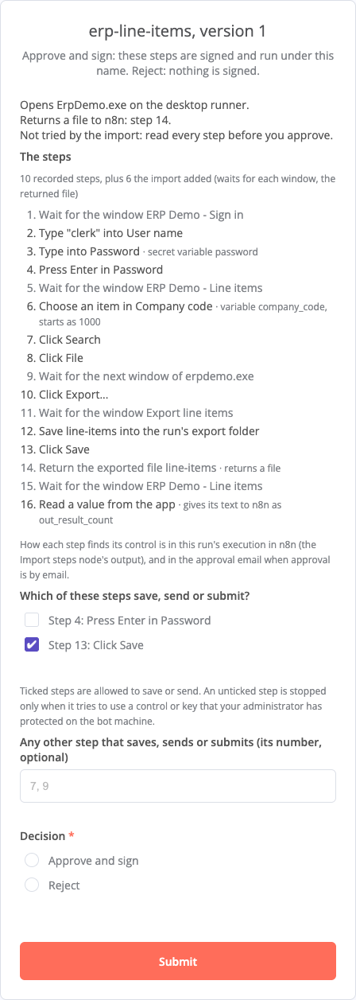

# Your first Windows desktop bot

This guide installs RPA on a Windows machine, sets n8n up for it with one command, records a bot in a Windows app,
approves it, and runs it from n8n with nobody signed in to Windows. It uses **ERP Demo**, a small sample app that comes
with the package. Plan for about 30 minutes.

> **Not released yet.** The Windows package and the n8n node version it needs (0.2.0) have not been published as a
> release. Until they are, build the package as [`desktop/README.md`](../../desktop/README.md#building-and-testing)
> says and run n8n from this repository's compose stack (step 1 of the [browser bot guide](browser-bot.md)).

## What you need

- **n8n** with the RPA node, version 0.2.0 or later. The quickest way is the compose stack in this repository:
  `printf 'BROWSER_TOKEN=%s\nN8N_ENCRYPTION_KEY=%s\n' "$(openssl rand -hex 32)" "$(openssl rand -hex 32)" > .env`, then
  `docker compose up --build -d`. Open http://localhost:5678 and create the owner account. When n8n offers its own
  Assistant, choose **Set up later in Settings**.
- **A Windows Server 2019 or later machine** (a virtual machine is fine) with an administrator account. n8n must reach
  it on TCP port 8765 (the runner). Note n8n's address as the Windows machine sees it.
- The app your bot drives, installed for all users under `C:\Program Files`. ERP Demo already is.

Two words first. The **bot user** is the Windows account the bots work as (`rpa-runner`). A **Connection Line** is one
line of text with all n8n needs to reach the Windows machine: its address, a token and its certificate's fingerprint.

## 1. Install RPA on Windows

On the Windows machine, open **Windows PowerShell** as administrator (Start, type `Windows PowerShell`, right-click it,
**Run as administrator**). Download the installer script and run it, with your n8n's address after `-AllowFrom`:

```powershell
[Net.ServicePointManager]::SecurityProtocol = 'Tls12'
Invoke-WebRequest -UseBasicParsing https://github.com/jb-n8n/n8n-nodes-rpa/releases/download/desktop-v<version>/Get-Rpa.ps1 -OutFile Get-Rpa.ps1
Set-ExecutionPolicy -Scope Process Bypass -Force
.\Get-Rpa.ps1 -AllowFrom <n8n address>
```

The installer lists what it will change and asks you to type `YES`. On Windows Server it sets up the **unattended**
mode: a Windows service signs the bot user in when n8n connects and signs it out afterwards, so nobody needs to stay
signed in. It ends with `RPA is installed.`, what is installed, `Next:`, and a question:
`Show the Connection Line now, to paste into the setup command? (y/N)`.

Type `y`. It prints the Connection Line with its token: keep the window open for step 2. The line starts
`rpa-runner://`. Its address is the name or address you gave the installer (it asks for one when n8n is outside this
machine's private network), else the one this machine has towards the n8n address you gave `-AllowFrom`, and the line
below it says which. If you answered no, or n8n reaches the machine by another name or address (a NAT, a tunnel), print
it in the same PowerShell: `& "C:\Program Files\RPA Runner\rpa.cmd" connection -ShowTokens`, with `-Address <that name or address>` if needed.

## 2. Set up n8n with one command

One command makes the **import form**, where you upload a bot, read its steps and approve them, and connects the
Windows machine. With the compose stack, run it inside the n8n container, in the repository folder. Nothing to
install, and no API key: it works through n8n's own command line.

```bash
docker compose exec n8n /opt/n8n-rpa/node_modules/.bin/n8n-nodes-rpa setup --windows
```

For an n8n you installed another way, with the node installed from **Settings → Community nodes**, run it where n8n
runs, as the user n8n runs as, for example
`docker exec -it <n8n container> node /home/node/.n8n/nodes/node_modules/n8n-nodes-rpa/dist/setup.mjs setup --windows`. Until 0.2.0 is on npm, run
`pnpm install`, `pnpm --filter n8n-nodes-rpa build`, then `node packages/n8n-nodes-rpa/dist/setup.mjs setup --windows` instead.
Its first lines say which way it took and why. Before it changes anything it checks that n8n's command line works on
the database of the n8n that runs there. As another user, or with another `HOME`, it would not, and it stops and says
so.

It asks for the Windows machine's line: paste the `rpa-runner://` line at `Paste the Connection Line, which starts
with rpa-runner:// (not shown), or press Enter to skip:`. The terminal shows nothing while you paste. Close the
PowerShell window on Windows afterwards: the line holds a token.

The command creates the **RPA Desktop Runner** credential with the line, an **RPA Step Signing** key, and the workflow
**RPA: 5 Import a bot** with both on its node **Import steps**, and publishes it. **Signing** marks steps as approved:
the bot runs only steps whose signature matches. The n8n owner is the approver (`--approver` names another). Then it
tests the Windows machine with the RPA node's own test, the one n8n runs when you open the credential: it connects
from n8n's machine and checks the certificate's fingerprint before it sends the token. It prints:

```text
Setting up n8n for RPA through n8n's own command line: no API key is needed.
Made "RPA Step Signing", "RPA Desktop Runner" and the form "RPA: 5 Import a bot".

The import form is ready.
  Sign-in:    your n8n login. The first time, n8n asks whether the form may use it: choose Allow access.
  Approvers:  you@example.com. Only the n8n users on "Sign steps" → Approver Allowlist may approve: add others there in n8n.
  Signing key: made by this run and kept in n8n, which does not show it again. Most people need no copy: it is for moving signed bots to another n8n, or for a lost n8n. To have one, run this again now, before you approve a bot, with --replace-signing-key --show-signing-key.
The Windows machine is connected. The test said: Connected to the desktop runner (its Windows session is ready for a run).
Next: open the address below. Upload a bot file (an RPA recording, a UiPath project, a Chrome Recorder export, Playwright code or a step document), name the steps and submit. Then review the steps and approve them.
  Address:    http://localhost:5678/form/rpa-import
```

The address ends in `/form/rpa-import`, or in a long id when another form in your n8n has that address already (the
command says so). When the machine does not answer, or the line is wrong, the last lines say
`The Windows machine is not connected yet.`, the reason and what to do, and the command asks once for a corrected line,
such as one printed again with `-Address`. `--verbose` prints every step the command takes.

**A second Windows machine.** Run the command again with `--windows` and paste that machine's line. As your project has
an RPA Desktop Runner already, it asks `Is the line for <address>:8765 another Windows machine (a), or a new line for
"RPA Desktop Runner" (s)? Enter changes nothing:`. `a` makes a credential of its own, named
`RPA Desktop Runner (<address>)` (with its port when it is not 8765), and tests it: pick it on the RPA node of each bot that runs there. The first
machine's credential is not touched, so its bots stay on it. `s` is for the same machine at a new address or with new
tokens: the new line is tested first, and replaces the old one only when the test reaches the machine.

If you made an RPA Desktop Runner credential in n8n already, leave out `--windows`: the command picks it when your
project has only that one, and puts it on **Import steps** of a form that has none (it never replaces one that is set). With several, add `--desktop-runner "<its name>"`. It never reads a credential's
values. It uses your project's **RPA Step Signing** credential whatever its name (n8n names one made by hand
`RPA Step Signing account`), and names it in the `Signing key:` line. With several, it asks which at a terminal, or
takes `--signing-key "<its name>"`: bots signed with one key do not run with another. The same goes for **RPA Browser**.
The signing key stays in n8n, which does not show it again. The `Signing key:` line says how to keep a copy:
you need one only to move signed bots to another n8n or for a lost n8n, so most people skip it. Without a copy, a lost key means approving
every bot again ([sign it again](move-a-bot.md#change-an-approved-bot-or-sign-it-again)).
Run the command again at any time: it reuses only what your own project owns, and asks first about what it finds in
another project. A form it made, or RPA 0.1.0 made, that differs from this version's template, for example after an
upgrade, is listed by what differs, with the question `Update this form to this version? (y/N)`. `--form-login basic` serves approvers with
no n8n account. To set the form up by hand, import `packages/n8n-nodes-rpa/templates/5-import-a-bot.json`
([Templates](../reference/templates.md#set-it-up-by-hand)).

Open the form's address once, in your browser, and sign in to n8n. The first time, n8n asks whether the form may use
your n8n login: choose **Allow access**. Someone who may not run the form's workflow sees n8n's own page
`Authorization unavailable` instead.

### No shell on n8n's machine: with an API key

Where you cannot run a command as n8n's user on n8n's machine, run `npx n8n-nodes-rpa setup --url <n8n address>`
(Node.js 22 or later) anywhere: it uses n8n's public API and asks for an API key. `--api-key` takes this way also
where the other would work, and `--no-api-key` refuses it.

1. In n8n, make an API key: **Settings → n8n API → Create API key**. Leave **Scopes** on **All**, and set
   **Expiration** to **7 days**, the shortest in its list. The stricter way: under **Scopes**, choose **Custom** and
   tick only `workflow:create`, `workflow:read`, `workflow:update`, `workflow:delete`, `workflow:list`, `workflow:activate`, `credential:create`, `credential:read`, `credential:update`, `credential:delete`, `credential:list`, `user:read`.
2. Run the command and paste the key when it asks `n8n API key (not shown):`.
3. Revoke the key when the command is done: **Settings → n8n API**, the key's **⋯**, **Revoke**. Its last lines say so.

This way, n8n tests the RPA Desktop Runner, and the last lines say whether the Windows machine is connected, as above.
A new line for a credential you have is tested first, in a credential of its own that the command deletes again: it
replaces the old line only when n8n's test reaches the machine.

## 3. Record the bot

1. On the Windows machine, sign in to **your own administrator session** (not as the bot user). Open **RPA Recorder**
   from the Start menu. A narrow bar opens at the top right of the screen and says `Ready`.
2. Choose **Start an app…**, then **Browse…** and pick `C:\Program Files\RPA Runner\erp-demo\v1\ErpDemo.exe`. Choose
   **Start recording**. The bar says `Recording ErpDemo.exe`.
3. Do the work once, as the bot should do it: sign in as `clerk` with the password `demo1234`, choose `1000` in
   **Company code**, click **Search**, then **File → Export...** and **Save**. Each step shows on the bar as a
   sentence. The recorder does not read the password box: that step types a **secret**, which n8n supplies later.
4. To return a value to n8n, point at it in the app (for example the result count) and press **F9**. In the
   **Read a value** window, keep or change the **Output name**, then choose **Add read step**.
5. Choose **Finish**. The bar asks `Which of these change from run to run?`. Tick the company code, keep the suggested
   name, and choose **Continue**.
6. Choose **Save**. The bar saves the recording in `Documents\RPA recordings` and lists two things left to do.
7. Next to **1. Allow ErpDemo.exe on this machine**, choose **Allow this app…**. Windows asks for administrator rights,
   and the policy tool shows what it will allow and asks: type `y` and Enter. The **policy** is the list of apps the
   bot may start, kept on this machine.
8. Next to **2. Import the recording in n8n**, choose **Open the import form**. The first time, it asks for the form's
   address: the one step 2 printed, with n8n's address as this machine sees it in place of `localhost`. Sign in to n8n
   in the browser that opens, and choose **Allow access** if n8n asks. The browser may offer to save the password. The
   recorder put the file's path on the clipboard: click **Bot file**, paste it in the window that opens, and Enter.

If this machine cannot reach n8n, choose **Show the file** instead, copy the `.rpa-recording.json` file to the computer
you use n8n from, and open the form there. [Record a bot](record-a-bot.md) explains every stage of the bar.

## 4. Import and approve

1. On the form (step 2 set it up, with its options), with the recording in **Bot file**, type `erp-line-items` in
   **Name for the steps**, and click **Submit**.
2. The next page, **Review and approve**, lists the steps by number. The lighter, grey steps are the ones the import
   added (a wait for each window, and one for the file the bot returns). Under **Which of these steps save, send or
   submit?**, keep **Click Save** ticked, and untick a step that does not save or send. Choose **Approve and sign**,
   then **Submit**.

   

3. The last page says `Approved and signed: erp-line-items version 1 is now the version that runs under that name.` The
   browser downloads `erp-line-items.workflow.json`, the workflow that runs the bot. The signed row records the email
   address of your n8n user as **approvedBy**. Someone not on **Sign steps → Approver Allowlist** cannot approve: the last page says
   `Sign Steps refused` and nothing is signed. The bot types a password, so the page ends with what to copy into the
   credential that holds it: `Credential: RPA Secret Variables`, `Name: password`, `May Be Typed Into: ErpDemo.exe`.
   It never asks for the password itself.

## 5. Run it

1. In n8n, create a workflow, **⋯ → Import → From File**, and pick `erp-line-items.workflow.json`, in the
   **Downloads** folder of the computer you approved on.
2. The RPA node is named after your bot (here **erp-line-items**), as is the workflow. Its **RPA Desktop Runner** and **RPA Step
   Signing** credentials are already picked: the setup command put them on the import form, and the form passes them
   on. Its **Runs On** is **A Windows desktop app**, so the node shows only the three slots a desktop bot uses, and no
   **Start URL**. **Signature** and **Approved By**, which the import sets, are on the node's **Settings** tab.
3. The third slot is yours: the password. On that node, create an **RPA Secret Variables** credential and copy into it
   the three values the last page and the gold note give: one variable named `password`, with the value `demo1234`,
   and `ErpDemo.exe` in its **May Be Typed Into**, which keeps the password to this app. **Options → Variables** already holds
   the company code you ticked, starting with the value you recorded. The credential is named
   `RPA Secret Variables account` unless you rename it. A later bot's workflow file names that credential, and n8n
   selects it by itself when exactly one has that name: add the later bot's variables to it.
4. Run the workflow (the **Execute** button at the bottom of the canvas). On the Windows machine nobody needs to be
   signed in: the service signs the bot user in, ERP Demo opens, works and closes, and the bot user is signed out
   again. The output holds the values you read with F9 under `values`, and the exported file in the **Binary** tab.

The first run after a quiet time waits while Windows signs the bot user in, about 5 to 20 seconds. If it fails with
`runner_unavailable`, run it again, then see the [Windows guide](../install/windows.md#11-when-something-fails).

Each run writes one row to the `playwright_runs` Data Table (**Log run**). A failed run writes its error code there
(**Log failed run**) and then stops at **Stop and Error**, so it shows as failed under **Executions**. To run the bot
on a schedule, open **On a schedule**, set the time, turn the node on, and **Publish** the workflow. To be told when a
scheduled run fails, choose an Error Workflow in the workflow's settings.

## When the app changes

After an update of the app, a step may no longer find its control: the run fails `drift_detected` and names the step.
To let the bot repair itself, follow the note on the RPA node: connect a chat model to its **Model** input, turn on
**AI Repair** and write the **Goal** in plain words (for example "Export the line items of company 1000 for 2026 as a
CSV file"), then send its **Repaired Steps** output to **RPA: 3 Approve steps**. Repair stays off until you do.

The next run that fails asks the model once. It looks at the app's window (no screenshot), points the failed steps at
the controls they moved to, starts the app again and replays the steps to prove them, without running anything that
looks like a save. The result is the next version of the steps, which waits for you: the approval email lists every
step, says which ones the repair changed or added and which ones it proved, and you tick the steps that save, send or
submit again. Ticks start from your approved version on the steps it did not change. Once you approve, the next run
uses the new version without the model. A repair that fails is not tried again until you approve a new version,
change the Goal, or change **Options → AI Repair Reset Key**. Details: [Steps](../reference/steps.md#ai-repair).

## Next

- Your own app: install it for all users, record it the same way, and allow it with **Allow this app…**, which also
  protects the buttons you clicked that save, send or post and have an id of their own, such as Post. The standard
  buttons of Windows dialogs (the Save of a Save As dialog, OK, Yes) are not protected. To protect other buttons or keys, an administrator lists them in the
  policy ([Windows guide](../install/windows.md#8-allow-your-own-app)).
- Change a value per run: map **Options → Variables** from an earlier node, such as a spreadsheet row.
- Change the company code you ticked: it is a run variable, so set it in the RPA node's **Options → Variables**, not
  on the import form's values page, which shows it without a field.
- Who may hold the secret variables, and how approval works: [Security](../reference/security.md).
