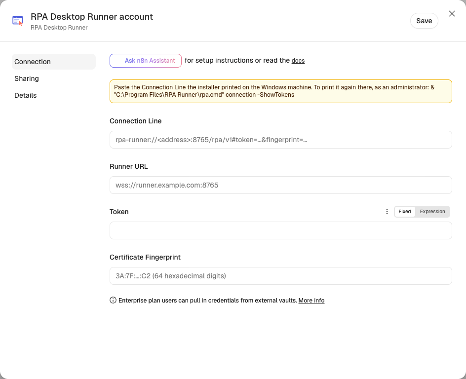
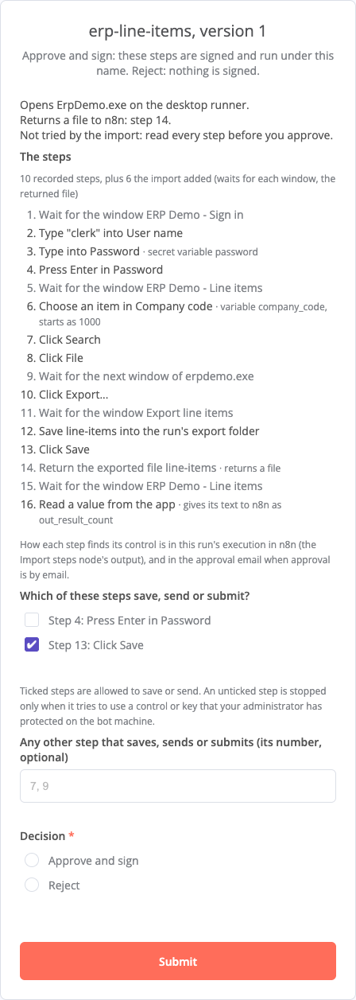

# Your first Windows desktop bot

This guide installs RPA on a Windows machine, connects it to n8n, records a bot in a Windows app, approves it, and runs
it from n8n with nobody signed in to Windows. It uses **ERP Demo**, a small sample app that comes with the package.
Plan for about 30 minutes.

> **Not released yet.** The Windows package and the n8n node version it needs (0.2.0) have not been published as a
> release. Until they are, build the package as [`desktop/README.md`](../../desktop/README.md#building-and-testing)
> says and run n8n from this repository's compose stack (step 1 of the [browser bot guide](browser-bot.md)).

## What you need

- **n8n** with the RPA node, version 0.2.0 or later. The quickest way is the compose stack in this repository:
  `printf 'BROWSER_TOKEN=%s\nN8N_ENCRYPTION_KEY=%s\n' "$(openssl rand -hex 32)" "$(openssl rand -hex 32)" > .env`, then
  `docker compose up --build -d`, then open http://localhost:5678.
- **A Windows Server 2019 or later machine** (a virtual machine is fine) with an administrator account. n8n must reach
  it on TCP port 8765 (the runner). Note n8n's address as the Windows machine sees it.
- The app your bot drives, installed for all users under `C:\Program Files`. ERP Demo already is.

Two words first. The **bot user** is the Windows account the bots work as: the installer creates `rpa-runner`. A
**Connection Line** is one line of text that holds everything n8n needs to reach the Windows machine: its address, a
token (a password) and the fingerprint of its certificate.

## 1. Install RPA on Windows

On the Windows machine, open **Windows PowerShell** as administrator (Start, type `Windows PowerShell`, right-click it,
**Run as administrator**). Download the installer script and run it, with your n8n's address after `-AllowFrom`:

```powershell
[Net.ServicePointManager]::SecurityProtocol = 'Tls12'
Invoke-WebRequest -UseBasicParsing https://github.com/jb-n8n/n8n-nodes-rpa/releases/download/desktop-v<version>/Get-Rpa.ps1 -OutFile Get-Rpa.ps1
Set-ExecutionPolicy -Scope Process Bypass -Force
.\Get-Rpa.ps1 -AllowFrom <n8n address>
```

It downloads the package, checks it, and starts the installer, saying each step in one line. The installer lists what
it will change and asks you to type `YES`. On Windows Server it sets up the **unattended** mode: a Windows service
signs the bot user in when n8n connects and signs it out afterwards, so nobody needs to stay signed in. It prints
`RPA is installed.` and then a summary of what it set up: the programs, the data, the policy, the tasks, the service,
the firewall rule and how to remove it all.

## 2. Connect n8n

In the same PowerShell, print the Connection Line with its token:

```powershell
& "C:\Program Files\RPA Runner\rpa.cmd" connection -ShowTokens
```

It prints a line under `Runner connection line, for the Connection Line of the RPA Desktop Runner credential:` that
starts `rpa-runner://`. The line holds a token: copy it straight into n8n, and close the window when you are done.
This guide needs no browser on the Windows machine. To add one, see the [Windows guide](../install/windows.md)
(`-WithBrowser`).

In n8n's left sidebar, choose **+ → New credential → RPA Desktop Runner**, paste the `rpa-runner://` line into
**Connection Line**, and click **Save**. The window says `Connection tested successfully`. If n8n reaches the machine
by another name or address than the one in the line (a NAT, a tunnel), run the command again with
`-Address <that name or address>`.



## 3. Record the bot

1. On the Windows machine, sign in to **your own administrator session** (not as the bot user). Open **RPA Recorder**
   from the Start menu. A narrow bar opens at the top right of the screen and says `Ready`.
2. Choose **Start an app…**, then **Browse…** and pick `C:\Program Files\RPA Runner\erp-demo\v1\ErpDemo.exe`. Choose
   **Start recording**. The bar says `Recording ErpDemo.exe`.
3. Do the work once, as the bot should do it: sign in as `clerk` with the password `demo1234`, choose `1000` in
   **Company code**, click **Search**, then **File → Export...** and **Save**. Each step shows on the bar as a
   sentence, such as `Type "clerk" into User name`. The recorder does not read the password box: that step types a **secret**, which
   n8n supplies later.
4. To return a value to n8n, point at it in the app (for example the result count) and press **F9**. A small
   **Read a value** window opens. Keep or change the name in its **Output name** box, then choose **Add read step**.
5. Choose **Finish**. The bar asks `Which of these change from run to run?`. Tick the company code, keep the suggested
   name, and choose **Continue**.
6. Choose **Save**. The bar saves the recording in `Documents\RPA recordings` and lists two things left to do.
7. Next to **1. Allow ErpDemo.exe on this machine**, choose **Allow this app…**. Windows asks for administrator rights,
   and the policy tool shows what it will allow and asks: type `y` and Enter. The **policy** is the list of apps the
   bot may start, kept on this machine. The bar then says the app is allowed.
8. Next to **2. Import the recording in n8n**, choose **Show the file**. Copy that `.rpa-recording.json` file to the
   computer you use n8n from.

[Record a bot](record-a-bot.md) explains every stage of the bar.

## 4. Import and approve

1. Set up the import form with one command, on the computer you use n8n from (Node.js 22 or later). It asks for an n8n
   API key (make one in n8n: **Settings → n8n API**) and does not show what you type. Answer `n` when it asks
   `Connect a Windows machine now?`: you did that in step 2.

   ```sh
   npx n8n-nodes-rpa setup --url http://localhost:5678 --approver you@example.com
   ```

   It creates a login for the form, an **RPA Step Signing** key and the workflow **RPA: 5 Import a bot**, with your
   address as the approver, and publishes it. **Signing** marks steps as approved, and the bot runs only steps whose
   signature matches. It ends with:

   ```text
   The import form is ready.
     Address:    http://localhost:5678/form/<id>
     User name:  rpa
     Password:   <32 characters>   (shown once: keep it in your password manager)
   ```

   The signing key stays in n8n, and n8n does not show it again. A lost key means approving every bot again. Add
   `--show-signing-key` to the first run to see it once. The command never changes a key that exists: only
   `--replace-signing-key` does, after you type `REPLACE`, and every bot signed with the old key must then be approved
   again. Run it again at any time: it reuses what it made, and `--new-form-password` gives the form a new password.
   It reuses only what your own project holds (your personal project, or the one `--project-id` names). A credential
   or workflow of the same name that belongs to someone else is left alone, and the command says so.

   Until version 0.2.0 is on npm, run it from this repository instead: `pnpm install`, then
   `pnpm --filter n8n-nodes-rpa build`, then `node packages/n8n-nodes-rpa/dist/setup.mjs setup` with the same options.
   To set the form up by hand, import `packages/n8n-nodes-rpa/templates/5-import-a-bot.json` as
   [Templates](../reference/templates.md#set-it-up-by-hand) says.
2. Open the form's address in your browser and sign in with the user name and password.
3. Upload the recording, give the steps a name such as `erp-line-items`, and submit.
4. The next page, **Review and approve**, lists the steps by number. The lighter, grey steps are the ones the import added (a wait
   for each window, and one for the file the bot returns). Under **Which of these steps save, send or submit?**, keep
   **Click Save** ticked, and untick a step that does not save or send. Choose **Approve and sign**, then **Submit**.

   

5. The last page says `Approved and signed: erp-line-items v1 is now the version that runs under that name.` Your
   browser downloads `erp-line-items.workflow.json`, the workflow that runs the bot.

## 5. Run it

1. In n8n, create a workflow, **⋯ → Import → From File**, and pick the downloaded `erp-line-items.workflow.json`.
2. On the RPA node, named after your recording (here **ErpDemo recording**), pick the **RPA Desktop Runner**
   credential and the **RPA Step Signing** credential.
3. The password is a secret variable. Create an **RPA Secret Variables** credential on that node, with one variable:
   the name its note gives (such as `password`) and the value `demo1234`. **Options → Variables**
   already holds the company code you ticked, starting with the value you recorded.
4. Run the workflow (the **Execute** button at the bottom of the canvas). On the Windows machine nobody needs to be
   signed in: the service signs the bot user in, ERP Demo opens, works and closes, and the bot user is signed out
   again. The output holds the values you read with F9 under `values`, and the exported file in the **Binary** tab.

The first run after a quiet time waits while Windows signs the bot user in, about 5 to 20 seconds. If it fails with
`runner_unavailable`, run it again, then see the [Windows guide](../install/windows.md#11-when-something-fails).

To run the bot on a schedule, open **On a schedule**, set the time, turn the node on, and **Publish** the workflow.

## Next

- Your own app: install it for all users, record it the same way, and allow it with **Allow this app…**. To protect
  its Save and Post buttons, an administrator lists them in the policy ([Windows guide](../install/windows.md#8-allow-your-own-app)).
- Change a value per run: map **Options → Variables** from an earlier node, such as a spreadsheet row.
- Who may hold the secret variables, and how approval works: [Security](../reference/security.md).
