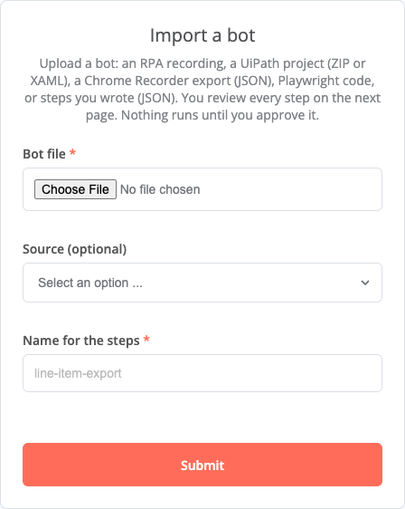

# Move a bot you already have

You can bring a bot over from a UiPath project, a recording of a website, Playwright code, a recording of a Windows
app, or steps you wrote. Each becomes a draft step list that a person reviews and approves on n8n's **Import a bot**
form before it runs. An import is a head start, not a full translation: the form and the import's report say what
was left out.

There is no importer for **Power Automate Desktop**. The [table below](#from-power-automate-desktop) maps its actions
to n8n.

## The import form

Template **RPA: 5 Import a bot** (`packages/n8n-nodes-rpa/templates/5-import-a-bot.json`) is a form in front of the
node's **Import Steps** operation. Set it up once, with one command (Node.js 22 or later, and an n8n API key from
**Settings → n8n API**: Scopes **All** and the shortest expiry, revoked right after, or the stricter **Custom** scopes
that [the browser bot guide](browser-bot.md#3-set-up-the-import-form-with-one-command) lists):

```sh
npx n8n-nodes-rpa setup --url http://localhost:5678
```

It creates the **RPA Step Signing** key and the workflow, and publishes it. The form opens with your n8n sign-in: it
has no password of its own. Your n8n user's email address goes on **Sign steps → Approver Allowlist** (the API key's owner, or
`--approver`). It prints the form's address. For approvers with no n8n account, `--form-login basic` gives the form a
user name and password instead, printed once. For browser bots, add
`--browser-url <ws-url>` with the browser service's token in `RPA_BROWSER_TOKEN`: it creates **RPA Browser** and
picks it on **Import steps**. With a Connection Line it creates **RPA Desktop Runner**. It puts the signing key and
the desktop runner on **Import steps** too, in two slots marked "only passed on to the workflow file": the import never
reads them, it writes their name and id into the workflow it hands over. A bot that signs in also needs an
**RPA Site Login** on **Import steps** and **Sign steps**. Make it in n8n first, then add `--site-login "<its name>"`:
the command picks that one of your project by its name, and never makes one or reads its values. For a site on this
computer or your own network, `--allow-private-network` turns on **Allow Private Network** on **Import steps**. Both
apply when the command makes the workflow: one there already is left as it is, and the command says what to set on it
in n8n. A bot that signs in with many accounts needs only one Site Login: see [One bot, many accounts](many-accounts.md). The
[desktop bot guide](desktop-bot.md#2-set-up-n8n-with-one-command) shows the output, and
[Templates](../reference/templates.md#set-it-up-by-hand) the way by hand.



Then, for each bot:

1. Upload the file. **Source** works it out from the file name, or choose it. Give the steps a **Name**: they are
   saved and run under that name.
2. The next page, **The file it downloads**, comes for every upload but an RPA recording or a step document (a step
   document's download steps carry their own checks). For a browser bot that
   downloads a file, a UiPath one too, give the file name pattern and the required columns. The replay checks that the
   bot gets that file. Leave both empty when the bot downloads nothing in a browser.
3. The import runs browser steps once and replays them in a fresh browser with every write blocked. Desktop steps are
   not replayed.
4. **Review and approve** shows each step list: what it opens, whether it signs in, and the numbered steps. When the
   import left a step out, a **Left out by the import** block lists it. Choose **Approve and sign** or **Reject**. The
   n8n user who submits this page is the approver: they must be on **Sign steps → Approver Allowlist**, or nothing is
   signed. The row records their n8n user's email address.
5. The last page says what was signed, and counts the values removed as secrets and the steps not translated. It
   downloads the workflow that runs the bot. When nothing was signed (rejected, or the approver is not on the list), it
   offers no workflow file. For a UiPath project, notes in that workflow show what was not
   translated, such as a credential lookup. A log message is dropped without a note. Import the workflow in n8n. Its
   RPA credentials are the ones the import used, already picked by name and id (never a value): check them, pick any
   other credential its notes name, and run it (the **Execute** button at the bottom of the canvas). Each run writes a
   row to the `playwright_runs` Data Table, and a failed run shows as failed under **Executions**.

To have a second person approve by email instead, follow the template's **Approval by email** note. The
[desktop bot guide](desktop-bot.md) walks the whole path with a recording.

**What is never imported.** A value typed into a password, PIN, secret or code field, or equal to the Site Login's
username or password, is removed. A browser sign-in becomes one `signIn` step that types the **RPA Site Login**'s
values, so a bot that signs in needs a Site Login on **Import steps**. Without one, the import says
`The recording signs in: attach an RPA Site Login so the import can sign in without the typed password.`

**When the sign-in is refused.** If the sign-in stops at a page the Site Login does not list, the form shows **Add the
login page**: add the address it names under **Pages Where the Password May Be Typed**, then choose **Import again**.
If a step is blocked because the site posts to read (SAP pages do), the message names the request: add it under
**Requests That Only Read** ([Security](../reference/security.md#sites-that-post-to-read)).

## From UiPath

Zip the project folder (the one with `project.json`), or pick one `.xaml` workflow, and upload it.

**What comes over:**
- Browser and desktop UI activities: Click (a double click becomes `doubleClick`), Type Into, Select Item, Check,
  Hover (browser), Send Hotkey and Keyboard Shortcuts, and on the desktop Get Text as a `read`. Their selectors become locators.
- Open Application, Use Application and Attach Window give the app the desktop steps start.
- A file typed into a Save dialog becomes the run's export folder and an `expectFile` step that returns the file.
- Credentials and Type Secure Text become the Site Login's sign-in (browser) or a secret variable (desktop).
- A variable that desktop steps type or choose starts, in the generated workflow, with the value the project gives it:
  its argument's default, or what the invoking workflow passes in (a plain value, or a variable's default). Change it
  on **Run steps**. A secret variable never gets one, whatever the letter case, nor a name that reads like a password,
  PIN, secret or token, nor a value of the RPA Site Login or one the import removed as a secret. A value set by an expression is left empty.
- Around the steps, in the generated workflow: If, For Each, Switch, Read Range and Write Range, HTTP Request, Send
  Outlook or SMTP mail, Delay and Invoke Workflow File become n8n nodes, with notes for what to fill in.
- Retry Scope, Try Catch, Check App State, Element Exists, While, Flowchart and State Machine: the UI activities inside
  are imported in order, and the report says what the block did that the steps do not (a retry, a loop, a decision).

**What is left out, and reported:** the browser's Get Text and Extract Data (write an `extract` step), Orchestrator
assets and queues, Catch branches, wildcard and fuzzy selectors, image and computer-vision targets, Java apps, Citrix
and Remote Desktop windows, and SAP GUI for Windows. A UiPath project gives one step list per sequence, named
`<name>-1`, `<name>-2`. In the workflow it hands over, each RPA node has the name of its step list.

## From a website recording or Playwright code

- **Chrome Recorder**: in Chrome DevTools, open the **Recorder** panel, record the task once, then **Export → JSON**.
  Hovers and scrolls are dropped.
- **Playwright code**: run the Playwright recorder, `npx playwright codegen https://example.com`, and save the
  JavaScript or TypeScript it writes. Python, Java and C# are refused:
  `Only JavaScript or TypeScript Playwright code can be imported; record with --target javascript.`

Clicks, typing, choices, checks and Enter come over, and from Playwright code also hovers, clicks with Ctrl, Shift
or Alt held, and key presses. A file upload and page JavaScript have no step and are reported. Steps that read no rows and download
no file cannot be proved by a replay:
`These steps read no rows and download no file, so there is nothing to prove: the draft is returned for review but cannot be signed.`

## From a recording of a Windows app

Record the work with the RPA Recorder and upload the `.rpa-recording.json` file: [Record a bot](record-a-bot.md).

## From steps you wrote

Write the steps as JSON ([Steps](../reference/steps.md)), save them as a `.json` file, and upload it with the source
**Step document**. This is how hand-written or hand-fixed steps get approved and signed. Steps that submit a form,
download through a form, type a secret or change a password are not run by the import: they go to approval as
written, marked so.

Steps that read rows need an `idPattern` on each `extract` and `extractTable` step ([ID Pattern](../reference/steps.md#id-pattern)).
The import checks the rows it reads with it, and the workflow file's **Run steps** gets the same **ID Pattern**. The
form asks for nothing more. Without one, the last page says:
`These steps read rows, but a step that reads them has no idPattern, so the replay cannot check the rows: the draft is returned for review but cannot be signed. Give each extract and extractTable step an idPattern, the shape of the ID every row has, such as INV-\d{4}.`

## Change an approved bot, or sign it again

1. Open the **Import a bot** form. Leave **Bot file** empty and type the bot's name in **Name for the steps**.
2. The next page shows the steps that run now under that name, to read or copy. Leave the box empty to sign them
   again, for example after the signing key changed. To change them, copy the steps into an editor, change what you
   need, and paste the whole step document into the box.
3. Click **Review**. The review page of an import follows: read every step, check the write ticks of desktop steps,
   and choose **Approve and sign** or **Reject**.

With the box left empty, the steps are the active row's steps as the workflow reads them from the Data Table: they do
not pass through your browser. Pasted text is taken as you typed it. The review page's first line says whether the
steps differ from the approved version, and which steps or settings do. Text that is not a step document ends on a
page that says so, and nothing changes.

Approved, the steps become the next version under that name (version 2 replaces version 1), signed with the current
key, and the old row is superseded: the bot's workflow runs the new version as it is. The last page says
`Signed again: <name> version 2, unchanged.`, or `Changed: <name> version 2 is now the version that runs, replacing
version 1.` Rejected, or not answered within an hour, the old version keeps running, and the last page says `Nothing
changed: <name> version 1 keeps running.` This path offers no workflow file. A name the form does not find ends on a page that lists the approved
bots.

## From Power Automate Desktop

There is no importer. Rebuild the flow in n8n: record each UI part with a recorder, and use n8n nodes for the rest.

| Power Automate Desktop | Here |
|---|---|
| UI automation (click, populate text field, select, check) | Record it with the RPA Recorder: desktop steps |
| Browser automation | Record it with Chrome's Recorder or Playwright and import it, or use the node's quick operations (Screenshot, Get Page, Extract Data, Fill and Submit Form, Download File) |
| Extract data from web page | Extract Data, or an `extract` step |
| Get details of a UI element (desktop) | F9 in the recorder: a `read` step |
| Send keys | Recorded keys: `key` (desktop) or `press` (browser) |
| Variables, Text, Date time | n8n's Edit Fields (Set) and Date & Time nodes, and expressions. Values reach steps as `{{var.name}}` |
| Conditionals (If, Switch) | n8n's If and Switch nodes. Inside browser steps, `when` |
| Loops (Loop, For each) | n8n's Loop Over Items, or one run per item. No loop inside desktop steps |
| Wait | n8n's Wait node, or a `waitFor` step |
| Run subflow | n8n's Execute Workflow node |
| On block error | The node's error output, **Retry On Fail**, and n8n's Error Workflow |
| Excel | n8n's Extract from File and Convert to File for files, Microsoft Excel 365 for files in Microsoft 365. Driving the Excel app itself was not tested |
| Email, Outlook | n8n's Send Email, Email Trigger (IMAP), Microsoft Outlook and Gmail nodes |
| HTTP, web services | n8n's HTTP Request node |
| Database | n8n's database nodes, such as Postgres, MySQL and Microsoft SQL |
| File, Folder, Compression | n8n's Read/Write Files from Disk and Compression nodes, on the n8n machine. A desktop run returns files its app saved (`expectFile`). Nothing puts a file on the Windows machine |
| Clipboard | Read only: a desktop `read` with `clipboard` right after a Copy click |
| Scripting (PowerShell, Python, VBScript, JavaScript) | n8n's Code node (JavaScript or Python), which runs in n8n. Nothing runs a script on the Windows machine |
| Run application | A desktop run starts its one allowed app and closes it at the end |
| Display message, input dialog | An n8n form, or an email that waits for an answer |
| Credentials | RPA Site Login (browser sign-ins) and RPA Secret Variables (desktop secrets) |
| Mouse at a position, image-based clicks, OCR | No equivalent |
| Terminal emulation, Citrix, SAP GUI for Windows | No equivalent |
| Triggers and schedules | n8n's Schedule Trigger, Webhook, Form Trigger and Email Trigger |

## From toema/n8n-playwright

`toema/n8n-playwright` runs verbs in one browser that later nodes reuse. Here each item runs in a fresh browser, so put
a whole job in one operation.

| In toema/n8n-playwright | Here |
|---|---|
| Navigate | The **URL** of any operation, or a `goto` step |
| Screenshot | **Screenshot** |
| Get Text | **Get Page**, or **Extract Data** for a table or list |
| Click, Fill | **Fill and Submit Form** for one form, **Run Steps** for more |
| Custom Script | **Run Steps**. There is no JavaScript step: JavaScript cannot be signed or held to the allowed sites. A step list can be signed, repaired and approved |

Sites are allowed one by one (add more under **Also Allow These Sites**), private addresses need **Allow Private
Network**, and sign-ins use an **RPA Site Login**, not a typed password.
